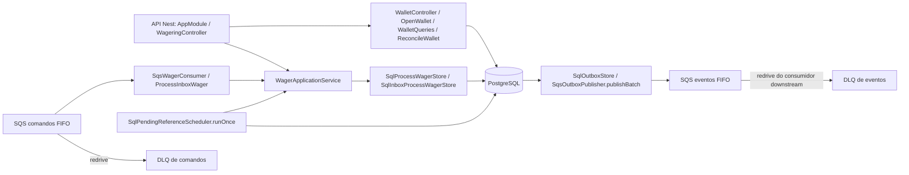
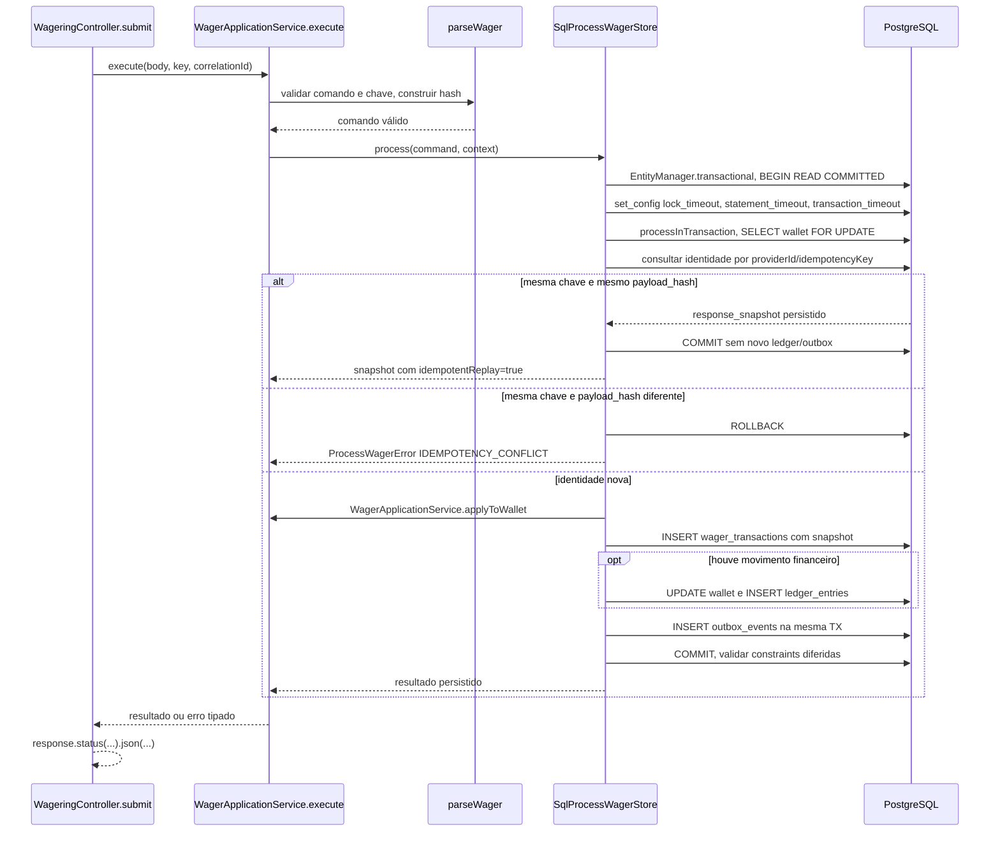
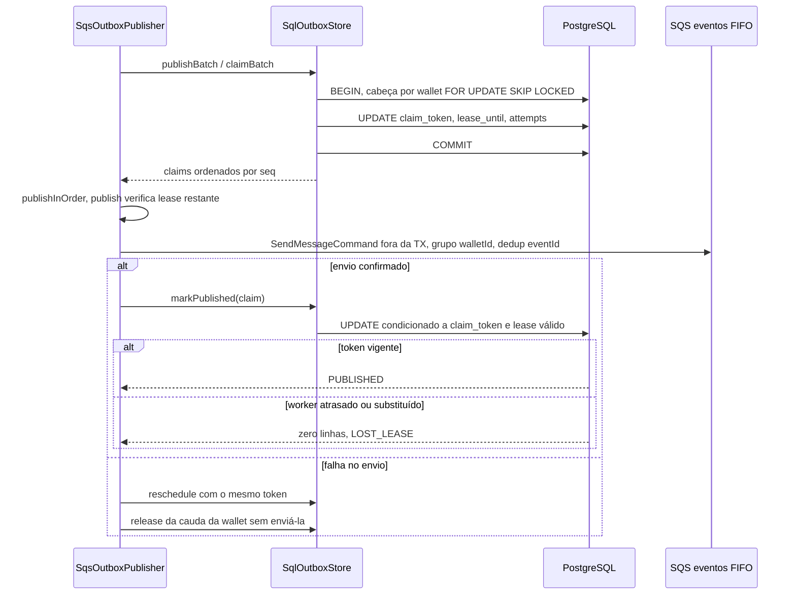
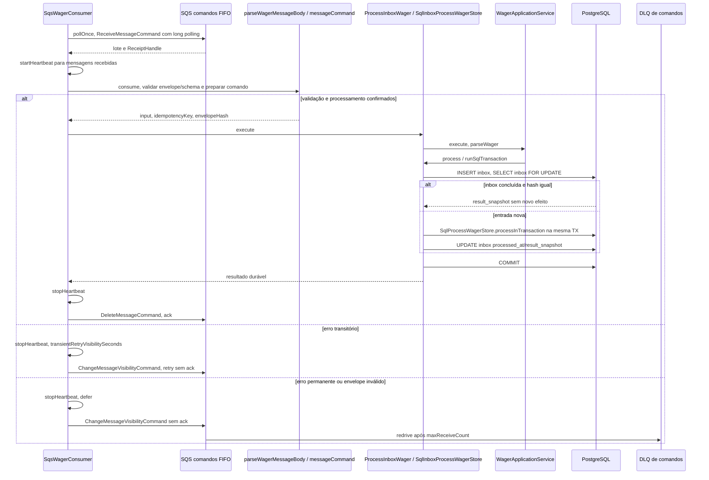
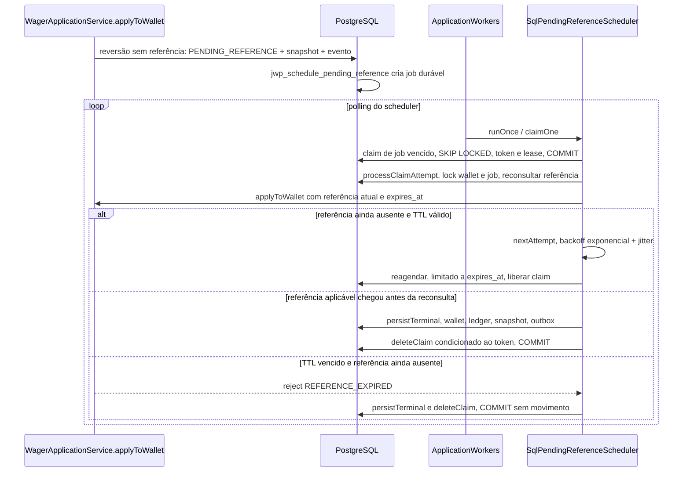
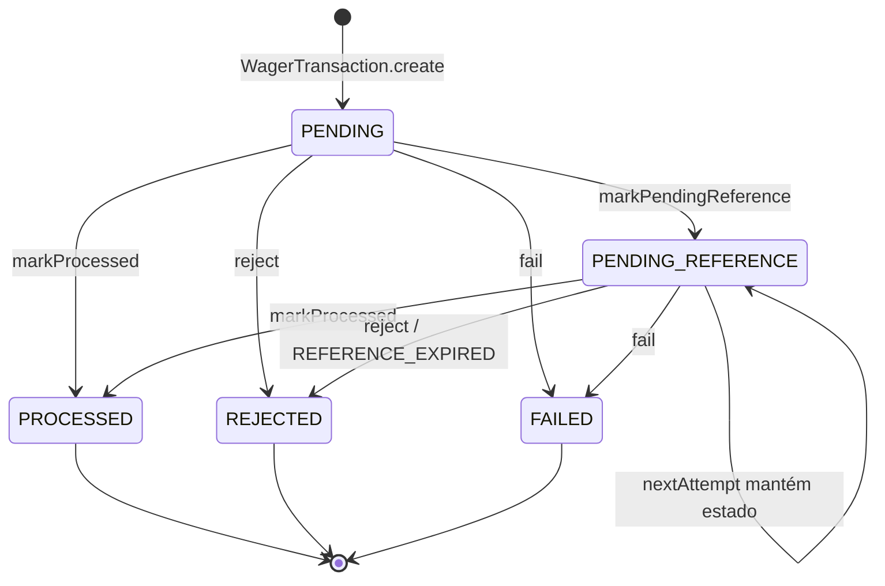

# Arquitetura — decisões e garantias

Este documento registra as decisões técnicas do serviço, por que foram tomadas, o que custam e onde estão provadas. O enunciado está em [docs/CHALLENGE.md](docs/CHALLENGE.md) (snapshot do upstream `c7143e6d041585d6913f56eb7415105e074f83dc`). O contrato HTTP e os códigos de erro estão em [docs/HTTP.md](docs/HTTP.md); o estado do produto e os limites conhecidos, em [docs/STATUS.md](docs/STATUS.md).

## Visão geral

Monólito modular com os contextos wallet, wagering e messaging. O mesmo `dist/main.js` sobe HTTP, workers (consumer de comandos, publisher da outbox e scheduler de referências) ou os dois, conforme `APP_ROLES`: `bun run start` é só HTTP e `bun run start:workers` é HTTP + workers. O Compose completo usa 3 réplicas combinadas; a carga usa por padrão 3 processos HTTP e 3 de workers. Cada processo tem event loop e pool próprios (até 4 conexões) e todos compartilham o PostgreSQL e as filas. Saldo, ledger, registro da aposta, inbox e outbox ficam no mesmo banco para que uma única transação local os confirme juntos. O schema é versionado pelas migrations 002–009 (`bun run db:migrate`); o runtime nunca aplica DDL.

API e workers compartilham as decisões de `WagerApplicationService`; adapters controlam a transação e a identidade durável.\
Wallet, ledger, inbox e outbox usam PostgreSQL para confirmar o efeito financeiro junto com sua evidência.\
SQS é acessado depois do commit; a entrega pode repetir e exige deduplicação persistente.\
`ApplicationWorkers.start` inicia consumer, publisher e scheduler; o consumo downstream de eventos é uma responsabilidade separada.

Fontes: [src/wagering/http/wagering.module.ts:20](src/wagering/http/wagering.module.ts#L20), [src/wagering/application/process-wager.ts:88](src/wagering/application/process-wager.ts#L88), [src/runtime/workers.ts:35](src/runtime/workers.ts#L35).

Adapters dependem da aplicação; a aplicação depende do domínio e de portas; a infraestrutura implementa as portas. Classes de domínio não têm decorators de framework nem de ORM. `WagerApplicationService` concentra decisões, snapshots e eventos para HTTP, SQS e scheduler; `WalletLedgerEntry`, `InboxMessage` e `OutboxMessage` participam das escritas reais.

Estrutura: `src/wallet/{domain,application,http,infrastructure}`, `src/wagering/{domain,application,http,infrastructure,events}`, `src/messaging` (adapters e workers), `src/shared/domain`, `src/observability`, `src/runtime`; testes em `tests/{unit,integration,concurrency,recovery,matrix,smoke}`.

## JWP-ADR-001 — Money exato com escala fixa

**Decisão.** `Money` guarda centavos em `bigint`, é imutável e entra/sai como string decimal com exatamente duas casas. O parser externo recusa negativos, arredondamento, notação científica, espaços, zeros à esquerda e número JSON. Soma e subtração nunca passam por `number`. No PostgreSQL o valor é `numeric(20,2)` mais a moeda; o driver devolve string e os adaptadores reconstroem `Money`.

**Motivo.** Débitos, créditos e reconciliação precisam preservar centavos exatamente, inclusive acima da faixa inteira segura de `number`.

**Faixa.** Até `999999999999999999.99` em módulo (20 dígitos em centavos, acima de um inteiro SQL de 64 bits). O registro de moedas aceita BRL, USD e EUR com escala 2 e a API financeira habilita as três, restringíveis por `JWP_ENABLED_CURRENCIES`; operações entre moedas diferentes falham, inclusive comparações ([JWP-ADR-016](#jwp-adr-016--multimoeda-com-escala-fixa-e-evolução-para-cripto-e-câmbio)).

**Consequências.** `bigint` dispensa biblioteca Decimal porque o domínio só soma e subtrai. Não há conversão cambial, divisão, juros ou arredondamento silencioso; se o domínio passar a exigir percentuais, a política de precisão precisa ser revista. A reconciliação soma em `numeric` ou em acumulador `bigint`, sem limitar subtotais à faixa de um saldo: o volume histórico pode exceder a faixa embora o saldo final seja válido.

**Prova.** `tests/unit/money.test.ts`; colunas `numeric(20,2)` verificadas na matriz de entrega.

## JWP-ADR-002 — Lock por wallet em transação curta

**Decisão.** READ COMMITTED com `LockMode.PESSIMISTIC_WRITE` da entidade da wallet dentro de `EntityManager.fork().transactional()`; o MikroORM emite o lock de linha FOR UPDATE. Todas as mutações de uma wallet seguem esse protocolo; wallets diferentes não compartilham lock.

**Motivo.** Previsibilidade no caminho do saldo e menos lógica de repetição do que optimistic locking. `version` começa em 1 e só incrementa quando o saldo muda (LOSS, rejeição, referência pendente e replay não incrementam); serve para auditoria e eventos, não como barreira de concorrência.

**FOR UPDATE versus FOR NO KEY UPDATE.** Ambos serializam escritores da mesma wallet. Mantivemos FOR UPDATE para preservar o protocolo único já exercitado por HTTP, SQS, scheduler, reconciliação e triggers; não há prova de que o modo mais fraco melhore essa carga. A [matriz de locks do PostgreSQL](https://www.postgresql.org/docs/17/explicit-locking.html#LOCKING-ROWS) distingue os modos. O custo do modo atual é conflitar também com KEY SHARE, inclusive validações de FK de outras transações. FOR NO KEY UPDATE poderia permitir essas leituras de chave, mas a troca exige medir a contenção e repetir as corridas/constraints; não é necessária para a correção atual. Prova do protocolo: `tests/concurrency/multi-process/multi-process.test.ts`, cenário `100/80/80 on 20 wallets in parallel: HTTP x HTTP on different instances and HTTP x SQS each debit exactly once`.

**Ordem de lock.** Inbox lógica (quando a entrada é SQS) → wallet → transação e referência. Workers fazem o claim em transação curta, liberam o lock do job e só então entram na ordem financeira. HTTP, SQS, scheduler e reconciliação seguem o mesmo protocolo. A unicidade entre requisições que apontam para wallets diferentes vem do banco (constraints), não do lock; após colisão de identidade, a leitura é repetida em transação nova.

**Consequências.** Uma wallet muito concorrida tem limite serial: a varredura de carga mediu ~4 ms de seção crítica por transação ([docs/LOAD_TEST.md](docs/LOAD_TEST.md)). Deadlock, serialization failure e lock timeout repetem a unidade inteira com limite e jitter; saldo insuficiente é regra de negócio, não retry.

**Prova.** `tests/matrix/delivery/matrix.test.ts` (cenário da seção 8 em três instâncias), `tests/concurrency/multi-process`.

## JWP-ADR-003 — Schema e barreiras de integridade

**Decisão.** As garantias de unicidade, imutabilidade e não negatividade ficam no schema, não só no código. Migrations versionadas e reversíveis 002–009; a numeração começa em 002 porque a 001 pertencia a um experimento de persistência removido antes da entrega. `down` é para bancos descartáveis de teste; reversibilidade de schema não torna seguro apagar dados em operação.

**Motivo.** Escritas concorrentes e SQL direto também precisam respeitar as invariantes financeiras, mesmo quando uma validação da aplicação for omitida.

**Consequências.** Constraints e triggers acrescentam custo ao commit e exigem testes de migration e de privilégios. Uma violação desfaz a transação inteira; o runtime não pode flexibilizar essas barreiras.

| Entidade | Barreira |
|---|---|
| Wallet | PK UUID; UNIQUE(player_id,currency); balance `numeric(20,2)` NOT NULL, ≥ 0 e diferente de NaN; version ≥ 1; moeda permitida |
| WagerTransaction | UNIQUE(provider_id,idempotency_key); UNIQUE(provider_id,external_transaction_id); hash e dados de negócio imutáveis; FK para a wallet com player e moeda compatíveis |
| Referência | Lookup por provider/external ID; FK interna quando resolvida; trigger garante mesma wallet, player, provider, moeda e round |
| Reversão aplicada | UNIQUE parcial em `reference_transaction_id` para REFUND/ROLLBACK PROCESSED, sem `kind` (Migration202610110004); rejeição não consome a vaga |
| Ledger | UNIQUE(wallet_id,transaction_id) e UNIQUE(wallet_id,wallet_version); before/after ≥ 0; amount > 0; aritmética da direção validada por CHECK |
| Inbox de comandos | PK `(consumer_name,message_id)`; hash e `received_at` imutáveis; `processed_at` e snapshot gravados juntos e imutáveis depois |
| Jobs de referência | `pending_reference_jobs` com lease, tentativas e TTL |
| Inbox de eventos | `wager_event_inbox`, usada pelo consumidor de referência (ADR-007) |
| Outbox | `event_id` único; envelope congelado; `published_at`, `attempts`, `next_attempt_at`, lease; `seq` para ordem por wallet (007); índice de origem por transação (008) |

**Imutabilidade do ledger.** A role de runtime só tem SELECT/INSERT no ledger; triggers BEFORE UPDATE/DELETE/TRUNCATE lançam exceção; FKs sem cascade destrutivo. A role de migrations é separada. Um superusuário ainda pode desativar proteções; a garantia vale para a role de runtime.

**Consistência entre linhas.** Constraint triggers DEFERRABLE INITIALLY DEFERRED validam no commit: transação monetária PROCESSED tem exatamente um lançamento; LOSS e não processadas não têm; direção, valor e contexto batem com a transação e a referência; saldo e versão finais batem com a cadeia do ledger; mudança de saldo sem lançamento falha. A validação é incremental (encadeamento dos lançamentos novos com o anterior); a verificação completa fica com a reconciliação.

**Escala.** `numeric(20,2)` faz cast antes do CHECK, então a recusa de três casas decimais acontece no contrato e no mapeamento, não no banco.

**Índices.** `(wallet_id,wallet_version)` no ledger, `(provider_id,external_transaction_id)` na identidade externa, `pending_reference_ready(next_attempt_at,transaction_id)`, `outbox_ready(next_attempt_at,event_id)` e `outbox_wallet_pending(wallet_id,seq)` parciais para eventos não publicados, e `outbox_transaction_origin_idx(transaction_id,created_at,event_id)`. O cursor do ledger é opaco, codifica wallet e versão e não usa offset.

**Prova.** `tests/integration/schema` (up/down/up, UPDATE direto no saldo, lançamento incompatível, role pré-provisionada), matriz de entrega no LOGIN de runtime.

## JWP-ADR-004 — Idempotência de negócio e replay

**Decisão.** O header `Idempotency-Key` é obrigatório e é a fonte da verdade no HTTP; no SQS a chave vem em `data.idempotencyKey`. A unicidade é por provedor: UNIQUE(provider_id,idempotency_key) e UNIQUE(provider_id,external_transaction_id). Provedores diferentes podem usar a mesma string de chave.

**Motivo.** Timeout e redelivery não permitem ao cliente saber se houve commit; repetir a identidade precisa recuperar o resultado sem repetir o efeito financeiro.

**Consequências.** Hash, identidades e snapshot ocupam armazenamento durável. O cliente deve conservar a chave no retry; trocar a chave para a mesma identidade externa gera conflito, não uma nova operação.

**Hash.** SHA-256 do JSON UTF-8 canônico (chaves ordenadas recursivamente) de providerId, externalTransactionId, playerId, walletId, roundId, gameId, kind, money e a referência opcional. playerId e walletId (UUIDs) entram em minúsculas; os demais identificadores são opacos e mantêm a caixa. Header, correlationId, messageId e occurredAt ficam fora. Campos desconhecidos são recusados; `null` é inválido e ausência é omitida.

**Resultado.** Mesma chave e mesmo hash → replay. Mesma chave com hash diferente → 409 `IDEMPOTENCY_CONFLICT`. Mesma identidade externa com outra chave → 409 `EXTERNAL_IDENTITY_CONFLICT`, sem novo efeito; o cliente recupera a operação pela consulta por provider/externalId. Isso impede que trocar a chave vire um novo débito.

**Snapshot.** A resposta terminal (transactionId, status, failureCode, saldo observado sob o lock, status HTTP) é gravada com a transação. Replay terminal muda apenas `idempotentReplay` para `true` e não consulta o saldo atual. Enquanto pendente, o replay devolve o estado atual com 202.

**Inserção concorrente.** Uma violação de unicidade aborta a transação; a operação recomeça em transação nova e lê o vencedor. Nunca se continua numa transação abortada, nem se dá ack SQS sem inbox e resultado confirmados.

**Prova.** `tests/matrix/delivery/matrix.test.ts` (50 envios paralelos, conflito, caixa de UUID), `tests/unit/process-wager.test.ts`.

## JWP-ADR-005 — Referências, estados e reversão única

**Decisão.** Persistir referências fora de ordem para resolução pelo scheduler; aplicar no máximo uma reversão por transação referenciada; confirmar LOSS sem efeito monetário.

**Motivo.** A ordem de chegada entre canais não é garantida. REFUND e ROLLBACK concorrentes da mesma BET não podem creditar o stake duas vezes.

**Consequências.** Pendências exigem jobs, backoff, lease e prazo finito. A regra de reversão é mais restritiva que a redação por tipo do enunciado; o cliente recebe uma rejeição auditável quando a vaga já foi consumida.

**Estados.** PENDING → PROCESSED, REJECTED, FAILED ou PENDING_REFERENCE; PENDING_REFERENCE → PROCESSED, REJECTED ou FAILED. Enquanto aguarda, só reagenda; o evento de pendência é emitido uma vez. Estados terminais são imutáveis; tentativa de transição lança `InvalidTransactionStateError extends WagerError`, conservando `INVALID_TRANSACTION_STATE`.

**Resolução.** Referência ausente → aguardar. Se existe, contexto, tipo e self-reference são validados primeiro; invalidade conhecida é rejeitada sem esperar o TTL. Referência compatível ainda não aplicada → aguardar. Referência aplicada → validar valor integral e disponibilidade de reversão. REFUND credita uma BET; ROLLBACK inverte BET, WIN ou REFUND; LOSS, OPENING e ROLLBACK não são revertidos. `gameId` não entra na comparação porque o enunciado não o exige.

**Prazo.** TTL de 15 minutos desde a aceitação persistida, backoff com base 1 s, fator 2, teto 60 s e jitter. No vencimento, a referência é reconsultada sob lock antes de rejeitar com `REFERENCE_EXPIRED`, para resolver a corrida com a chegada tardia; não há reabertura automática.

**Relógio.** No scheduler, o timestamp da transição é `max(relógio do worker, createdAt, pendingReferenceAt)`, para nunca anteceder a aceitação quando há diferença de relógio entre hosts. O lease continua validado só pelo relógio do worker e não é estendido.

**Reversão única por referência.**
- *Requisito do enunciado* ([docs/CHALLENGE.md §7](docs/CHALLENGE.md#7-regras-de-negócio)): a tabela diz que REFUND "reverte uma `BET` `PROCESSED`, uma única vez" e que ROLLBACK "reverte uma transação `PROCESSED`, uma única vez". A regra 4 diz: "uma referência não pode ser revertida duas vezes pelo mesmo tipo de operação". O enunciado pede que interpretações adicionais sejam documentadas.
- *Interpretação.* Uma transação referenciada é revertida no máximo uma vez, qualquer que seja o tipo. A regra adotada contém a regra 4 e é mais restritiva: REFUND e ROLLBACK da mesma BET também não coexistem.
- *Motivo.* Os dois creditariam o mesmo stake. Exemplo: 100,00 → BET 25,00 → REFUND → 100,00; um ROLLBACK da mesma BET levaria a 125,00, um crédito duplicado que viola a correção financeira. A leitura literal "por tipo" permitiria esse caso.
- *Comportamento.* A primeira reversão PROCESSED vence; a segunda vira REJECTED/`ALREADY_REVERSED` (422, persistida com evento). ROLLBACK de um REFUND continua permitido, pois referencia o próprio REFUND. ROLLBACK de ROLLBACK é proibido. WIN que referencia a BET não é reversão.
- *Código.*
  - Domínio: `WagerTransaction.referenceDecision` em [wager-transaction.ts](src/wagering/domain/wager-transaction.ts) (`alreadyReversed` → `ALREADY_REVERSED`).
  - Consultas sob o lock da wallet em [sql-process-wager-store.ts](src/wagering/infrastructure/sql-process-wager-store.ts) (HTTP/SQS) e em [pending-reference-scheduler.ts](src/messaging/pending-reference-scheduler.ts).
  - Barreira final: índice único parcial `wager_one_reversal(reference_transaction_id) WHERE status='PROCESSED' AND kind IN ('REFUND','ROLLBACK')`, sem `kind`, em [Migration202610110004](src/persistence/migrations/Migration202610110004.ts) (ADR-003).
- *Prova.*
  - M08 em `tests/matrix/delivery/matrix.test.ts` (`M08 reversal addendum: one applied reversal per referenced transaction, any kind; ROLLBACK of REFUND allowed`): REFUND seguido de ROLLBACK resulta em 422 `ALREADY_REVERSED`, a ordem inversa também, e seis reversões concorrentes entre instâncias resultam em uma aplicada.
  - A preparação da matriz confere a definição do índice sem `kind`.
  - `tests/unit/wager-transaction.test.ts` (`self-reference and one reversal per type use explicit decisions; rejected identity is terminal`).

**LOSS.**
- *Requisito do enunciado* ([docs/CHALLENGE.md §7](docs/CHALLENGE.md#7-regras-de-negócio)): LOSS tem efeito "nenhum" no saldo, ledger "nenhuma" e "registra o resultado sem mover saldo". Operações sem efeito no saldo "não geram lançamento". `WagerTransactionProcessed` vale para "qualquer transação aplicada, inclusive `LOSS`". As regras 1 e 3 só exigem e definem referência para REFUND/ROLLBACK; na tabela, só WIN "pode referenciar a `BET`".
- *Interpretação.* LOSS usa exatamente `money.amount = "0.00"` e não aceita referência. É confirmado como PROCESSED com `WagerTransactionProcessed`, sem mudar saldo nem versão, sem ledger e sem `WalletBalanceChanged`. Valor diferente de zero ou referência são recusados com 400 antes da aceitação.
- *Motivo.* Um valor positivo sugeriria movimento que não existe e poderia ser confundido com débito. Uma referência à BET criaria um vínculo que não se resolve nem se reverte (LOSS não é revertido) e uma dependência PENDING_REFERENCE sem efeito financeiro.
- *Código.*
  - Fábricas e reidratação de `WagerTransaction` em [wager-transaction.ts](src/wagering/domain/wager-transaction.ts): `Loss ? !money.isZero() : !money.isPositive()` → `INVALID_WAGER`; referência só em WIN/REFUND/ROLLBACK.
  - `ledgerDirectionFor` devolve `undefined` para LOSS.
  - No banco ([financial-sql.ts](src/persistence/migrations/financial-sql.ts)): `CHECK ((kind='LOSS' AND amount=0) OR (kind<>'LOSS' AND amount>0))`, LOSS sem referência e ledger proibido para LOSS pelo constraint trigger.
- *Prova.*
  - `tests/unit/wager-transaction.test.ts` (`factories enforce external kinds, positive money and zero LOSS; OPENING is internal only`).
  - `tests/unit/integration-events.test.ts` (`LOSS emits Processed with unchanged wallet version and cannot emit BalanceChanged`).
  - `tests/integration/wager/process-wager.test.ts` (`BET, WIN, LOSS: exact amounts, historical snapshots and zero-effect LOSS`).
  - `tests/integration/schema/financial-schema.test.ts` (`LOSS and every non-PROCESSED status reject ledger; wager/ledger amount/direction must agree`).
  - M07 e M09 na matriz de entrega.

**Prova (demais regras).** M10 em `tests/matrix/delivery/matrix.test.ts` (referência fora de ordem via HTTP e SQS) e `tests/integration/messaging/scheduler/audit-regressions.test.ts`.

## JWP-ADR-006 — Atomicidade e inbox

**Decisão.** Uma transação SQL grava aposta, saldo, ledger, snapshot, inbox (entrada SQS) e eventos. Qualquer falha desfaz tudo. Rejeições de negócio são persistidas com evento, não lançadas como exceção que aborte a gravação.

**Motivo.** Confirmar a mensagem sem resultado durável perderia trabalho; confirmar o saldo sem ledger ou eventos impediria auditoria e recuperação.

**Consequências.** Inbox e domínio financeiro compartilham o PostgreSQL e o custo do commit. A fila só recebe ack depois da confirmação; falha posterior exige deduplicação na redelivery.

**Inbox.** Deduplica por `(consumerName, messageId)` do envelope. O hash cobre type, data canônica e idempotencyKey; metadados de entrega não contam. Reutilizar um messageId com conteúdo diferente é conflito e vai para a DLQ. Inbox já concluída confirma a redelivery sem novo processamento; o mesmo comando em outro envelope cai na idempotência de negócio (ADR-004). `processedAt` significa comando aceito duravelmente; uma referência pendente é trabalho durável do scheduler, então inbox concluída e ack acontecem após o commit mesmo com a aposta não terminal.

**Falhas.** Retry transitório nunca converte um registro confirmado em FAILED. Corpo inválido sem identidade fica como problema de transporte (DLQ), sem transação financeira fictícia.

**Prova.** `tests/integration/messaging`, `tests/recovery/crash` (SIGKILL após commit e antes do ack).

## JWP-ADR-007 — SQS e outbox

**Decisão.** Publicar eventos duráveis após o commit, com claim por lease e ordem por wallet, aceitando entrega at-least-once.

**Motivo.** Não há transação distribuída entre PostgreSQL e SQS; a outbox permite recuperar a publicação sem anunciar uma operação financeira desfeita.

**Consequências.** Claims e marcações exigem transações adicionais, e uma wallet quente tem publicação serial. Consumidores precisam deduplicar eventId; DLQ exige diagnóstico e redrive operacional.

**Comandos.** Filas FIFO com DLQ por redrive (`maxReceiveCount` 5). Produtores controlados usam `MessageGroupId = walletId`, mas o consumer aceita qualquer grupo e nunca usa isso como motivo de DLQ. Falha transitória devolve visibilidade `min(60, 3·2^(ApproximateReceiveCount−1))` s (3, 6, 12, 24, 48); falha permanente devolve 1 s. Com recebimentos em ~0, 3, 9, 21 e 45 s, a dependência precisa voltar até a quinta tentativa; depois disso a mensagem vai para a DLQ em ~93 s e exige redrive manual. A visibilidade inicial de 30 s é renovada por heartbeat a cada 10 s enquanto a mensagem não é resolvida. Em SIGTERM o polling para, as mensagens em andamento terminam dentro do prazo e as restantes voltam a ficar visíveis. Falha de DeleteMessage depois do commit é redelivery segura. Detalhes e medições em [docs/workers.md](docs/workers.md).

**Outbox.** Cada evento é gravado na transação financeira e publicado depois do commit em `wager-events.fifo`, separada dos comandos. O claim seleciona eventos vencidos com `FOR UPDATE SKIP LOCKED`, grava `claim_token`/`lease_until` e confirma; o envio acontece fora da transação e só um token ainda válido marca sucesso ou reagenda. Crash ou timeout liberam o trabalho pelo lease. Retry não muda eventId, envelope nem occurredAt; um evento confirmado nunca é apagado ao atingir o limite de tentativas.

**Ordem por wallet.** `outbox_events.seq` é identity, e todo writer grava a outbox segurando o lock da wallet, então `seq` segue a ordem de commit dentro da wallet. O claim só abre uma wallet pelo evento mais antigo não publicado, vencido e livre, e então reivindica um prefixo contíguo dela; entre publishers concorrentes, só um tem eventos de uma wallet em voo. O publisher envia em sequência dentro da wallet e em paralelo entre wallets; na primeira falha reagenda o evento e devolve o resto do prefixo sem enviar. Com `MessageGroupId = walletId`, cada wallet chega em ordem de commit. Custo: uma wallet quente é publicada por um publisher de cada vez.

**Entrega.** At-least-once: um evento pode ser reenviado depois de SendMessage e antes de `markPublished`, ou após lease perdido. O token impede que um worker antigo altere um claim novo, mas não cancela um envio já em rede; o consumidor deduplica por eventId e `walletVersion` permite detectar lacunas.

**Consumidor de referência.** `SqsEventConsumer` e a tabela `wager_event_inbox` implementam um consumidor downstream que deduplica eventId de forma durável. Ele não é composto no runtime (o serviço publica; quem consome é outro sistema); existe para provar, nos testes de integração, recuperação e matriz, que duplicatas da outbox são seguras para o consumidor.

**Intervalo dos workers.** O intervalo padrão de 250 ms não pausa lotes cheios: o consumer continua imediatamente quando as 10 mensagens recebidas são confirmadas, e a outbox quando o lote está cheio e todo publicado. Lotes vazios, parciais ou com falha voltam à pausa.

**Eventos.** `WagerTransactionProcessed` (inclusive LOSS), `WagerTransactionRejected`, `WagerTransactionPendingReference`, `WalletBalanceChanged` (só quando o saldo muda) e `WagerTransactionFailed` (ADR-011). O envelope é uma classe abstrata com subclasses concretas; `data` leva `MoneyProps`. Contratos em [contracts/messaging](contracts/messaging/README.md).

**Prova.** `tests/integration/messaging/outbox/outbox-publisher.test.ts` (dois publishers concorrentes e falha injetada no primeiro evento), `tests/integration/messaging/consumer-resilience.test.ts`, `tests/recovery/crash`.

Fontes: [visibilidade SQS](https://docs.aws.amazon.com/AWSSimpleQueueService/latest/SQSDeveloperGuide/sqs-visibility-timeout.html), [FIFO](https://docs.aws.amazon.com/AWSSimpleQueueService/latest/SQSDeveloperGuide/FIFO-key-terms.html).

## JWP-ADR-008 — Runtime

**Decisão.** Bun 1.3.14, TypeScript 5.9.3 estrito e NestJS 11.2.7, fixados no lockfile. O Nest roda no Bun depois do `tsc`, com DI explícita nos construtores. As migrations rodam com a credencial owner (`JWP_MIGRATION_DATABASE_URL`); o runtime usa um LOGIN membro de `jwp_runtime`. Readiness exige PostgreSQL e SQS em qualquer topologia HTTP; SQS sem filas configuradas produz 503, embora o processo HTTP permaneça vivo. O uso do MikroORM está na ADR-014.

**Motivo.** Compilar antes de iniciar torna o artefato executável independente de transformação TypeScript em produção. Separar owner de runtime restringe o processo às operações de dados necessárias.

**Consequências.** O início exige build e schema provisionado; instalar dependências não aplica migrations. Os papéis HTTP/workers precisam ser escolhidos explicitamente e cada processo mantém seu próprio pool.

**Prova.** `tests/smoke/bootstrap.test.ts` (DI e HTTP compilado), `tests/integration/runtime/workers-entrypoint.test.ts` (papéis e drain), `tests/integration/observability/readiness.test.ts` e `tests/integration/schema` (role runtime).

## JWP-ADR-009 — HTTP, códigos e diagnóstico

**Decisão.** Os status distinguem as situações que o provedor precisa tratar de forma diferente: 201 wallet criada; 200 operação terminal (inclusive replay); 202 pendente de referência; 400 payload, header ou contexto inválido; 404 recurso inexistente; 409 conflito de idempotência, identidade externa ou wallet duplicada; 422 rejeição de negócio persistida; 503 falha transitória de dependência (retryable); 500 falha permanente conhecida e auditada (não retryable). A tabela completa de códigos, a ação esperada do cliente e exemplos estão em [docs/HTTP.md](docs/HTTP.md).

**Motivo.** O cliente precisa distinguir retry, consulta de resultado e correção do comando sem inferir a situação a partir de uma mensagem textual.

**Consequências.** O 400 atual informa o código, mas não o campo inválido: `message` repete o código. Mantemos esse contrato; detalhes estruturados de campo/caminho ficam para uma evolução consistente entre endpoints. O cliente deve validar o payload e decidir pelo código, sem interpretar `message`.

**Observabilidade.** `/metrics` expõe séries agregadas: transações por status e kind, duplicatas por camada, retries, profundidade de filas e DLQs, espera de lock, outbox pendente e idade do mais antigo, latência HTTP e de processamento, divergências de reconciliação. Logs JSON carregam correlationId e identificadores de contexto, sem saldo, payload ou segredo; IDs não viram labels de métrica. O `correlationId` vem de `response.locals`, é o mesmo passado ao use case e gravado nos eventos, e não aparece nas respostas de sucesso.

**Health e identidade HTTP.** Live mede processo; ready exige PostgreSQL e SQS em qualquer papel HTTP. Sem SQS configurado ou alcançável, responde503 unavailable, conservando as checks para diagnóstico. Health fica público. A chave de idempotência é opaca, não vazia após trim e limitada a128 unidades UTF-16 sem NUL/substitutos isolados; formato inválido continua400 IDEMPOTENCY_KEY_REQUIRED. O padrão recomendado é providerId:externalTransactionId, sem exigir prefixo nem recompor o header. Contrato e testes de validação estão em docs/HTTP.md e process-wager.test.ts.

**Reconciliação.** Lê saldo e ledger sob lock curto da wallet, no mesmo ponto consistente, sem reparo automático; `difference = storedBalance − calculatedBalance` pode ser negativa. Divergência é logada, contada e sinalizada com `consistent: false`.

**Prova.** `tests/integration/query/compiled-runtime.test.ts`, `tests/integration/observability`.

## JWP-ADR-010 — Autenticação

**Decisão.** Sem IdP nesta entrega, como o enunciado permite. O ponto de extensão é explícito: `src/shared/http/provider-identity.ts` define `ProviderIdentityPort.identify(request)` e `ProviderAuthGuard`, registrado como `APP_GUARD`. Toda rota passa pelo guard, exceto `@PublicRoute()`: `/health/*` (público pelo enunciado) e `/metrics` (a restringir por rede numa implantação real). Uma porta que devolve `undefined` nega a requisição.

**Motivo.** A porta permite substituir a identidade local por autenticação real sem acoplar o domínio financeiro a tokens ou ao provedor de identidade.

**Consequências.** O modo local não oferece autenticação nem isolamento de autorização entre provedores; uma implantação pública precisa implementar o adapter e as políticas de leitura antes de expor a API.

**Modo local.** `LocalProviderIdentity` aceita qualquer chamada e não autentica o `providerId`, que continua sujeito às validações de domínio. Consumers SQS não passam pelo guard (canal interno confiável); quem publica na fila de comandos é limitado por IAM, com a política mínima em [docs/security/IAM.md](docs/security/IAM.md). Com `NODE_ENV=production`, `src/main.ts` recusa o boot com a identidade local (`INSECURE_LOCAL_AUTH_IN_PRODUCTION`), salvo `JWP_ALLOW_INSECURE_LOCAL_AUTH=true`. `HOST` padrão é `127.0.0.1`, inclusive na imagem; o Compose define `HOST=0.0.0.0` explicitamente.

**Desenho com IdP.** Um adapter OIDC (Keycloak ou equivalente) valida assinatura, issuer, audience e expiração do token, extrai o provedor autorizado e o cruza com o `providerId` do comando; leitura de wallets passa por política de autorização; sem tabela própria de senhas. Para integrar: implementar a porta e injetá-la em `AppModule.register(..., identity)`.

**Prova.** `tests/unit/provider-identity.test.ts`, `tests/unit/deploy-hardening.test.ts`.

## JWP-ADR-011 — FAILED auditável

**Decisão.** Uma falha permanente conhecida de infraestrutura (SQLSTATE `0A000`) na última tentativa produz a transação FAILED, gravada em nova transação depois de revalidar identidade, lock e lease. Snapshot, inbox (SQS) e o evento `WagerTransactionFailed` confirmam juntos; não altera saldo nem gera ledger. O snapshot preserva o saldo observado sob lock. Retry transitório e erro desconhecido não viram FAILED; se a gravação da auditoria falhar, o consumer não dá ack e a mensagem segue o fluxo de retry/DLQ.

**Motivo.** Uma falha permanente conhecida precisa deixar resultado terminal consultável, sem confundir indisponibilidade transitória com rejeição financeira.

**Consequências.** A auditoria depende de uma nova transação SQL e pode também falhar. Somente a classificação conhecida produz FAILED; falhas não classificadas conservam o caminho de retry/DLQ, e o cliente não pode assumir que toda resposta 500 criou um registro terminal.

**Prova.** `tests/integration/wager/permanent-failure.test.ts`; política em [docs/workers.md](docs/workers.md).

## JWP-ADR-014 — MikroORM como infraestrutura transacional e SQL explícito

**Decisão.** MikroORM 6.6.17 gerencia conexão, transação, fork do EntityManager, entidades de persistência e migrations. Os quatro locks simples usam `em.findOne` com `LockMode.PESSIMISTIC_WRITE` dentro da TX: wallet financeira, wallet do scheduler, transação pendente e wallet da reconciliação. `WalletRecordSchema` e `WagerTransactionLockSchema` mapeiam as leituras; o último precisa apenas da identidade para bloquear a linha. Não usamos persist/flush para as escritas financeiras. Claims SKIP LOCKED, leases/tokens, snapshots e escritas críticas continuam SQL explícito com `em.getTransactionContext()`. As classes de domínio permanecem independentes de NestJS/ORM.

**Motivo.** O SQL explícito deixa visíveis as queries, locks, papel de runtime, snapshots e fences que precisam ser revisados, e mantém a ordem de escrita e de lock sob controle direto.

**Consequências.** Mapeamento de escritas, reidratação e coerência entre schema e SQL são manuais. As leituras com lock usam `disableIdentityMap:true`: na versão fixada, o MikroORM cria um fork com `keepTransactionContext:true`, lê e limpa seu identity map. O lock dura até o fim da mesma TX; a entidade lida não fica gerenciada para o flush final, e o próximo lock lê os UPDATEs SQL atuais. Isso evita sobrescrever ou reutilizar saldo antigo. O teste de integração faz dois movimentos na mesma TX e verifica estado fresco e identity map vazio. Uma chamada que omitisse `em.getTransactionContext()` sairia da unidade atômica; esse argumento é parte do contrato interno de [SqlProcessWagerStore](src/wagering/infrastructure/sql-process-wager-store.ts) e [sql-transaction.ts](src/shared/infrastructure/sql-transaction.ts). O driver devolve `numeric` como string; a validação monetária efetiva é `Money` + classes de domínio + constraints e triggers do PostgreSQL.

**Alternativa considerada.** Escritas com Unit of Work/persist/flush exigiriam controlar sua ordem frente a snapshots, ledger e triggers. Mantivemos SQL nessas escritas e adotamos LockMode nos locks simples; claims compostos conservam SQL para expressar head/prefix por seq, SKIP LOCKED e fencing num único comando. O custo é manter e testar ambos os mapeamentos.

**Prova.** `tests/integration/wager/process-wager.test.ts`, teste `LockMode keeps row locking and fresh SQL state without retaining an identity map snapshot`; reprodução completa PG/SQS, concorrência multiprocesso, reconciliação sob lock e scheduler. O comando de reprodução registra a revisão e seus resultados, não certifica mudanças futuras.

Fontes: [transações MikroORM](https://mikro-orm.io/docs/transactions), [locks PostgreSQL](https://www.postgresql.org/docs/current/explicit-locking.html), [constraints PostgreSQL](https://www.postgresql.org/docs/current/ddl-constraints.html), [tipos numeric](https://www.postgresql.org/docs/current/datatype-numeric.html).

## JWP-ADR-015 — Migrations em SQL manual e guarda de drift contra as entidades

**Decisão.** O schema é definido só pelas migrations MikroORM com SQL escrito à mão (`src/persistence/migrations/`, Migration202610110002–Migration202610130009). Não usamos `schema:update` nem migrations geradas a partir das entidades. As duas entidades (`WalletRecordSchema`, `WagerTransactionLockSchema`, ADR-014) servem a leituras e locks e são conferidas contra o banco migrado por um teste automático de drift.

**Motivo.** O gerador de diff do ORM não expressa o que o schema financeiro precisa: índices únicos parciais (`wager_one_reversal` em `reference_transaction_id` só para REFUND/ROLLBACK PROCESSED; `outbox_ready`, `outbox_wallet_pending`, `pending_reference_ready`), CHECKs entre colunas, constraint triggers DEFERRABLE, triggers de imutabilidade, funções PL/pgSQL, grants da role `jwp_runtime` e backfills. Os claims `FOR UPDATE SKIP LOCKED` do outbox e do scheduler dependem desses índices parciais para não varrer linhas publicadas. Gerado contra as entidades atuais, o diff do ORM propõe apagar tabelas de mensageria, colunas de `wager_transactions`, CHECKs e índices parciais, e trocar `text` por `varchar(255)`. Aplicá-lo seria destrutivo.

**Locks e CONCURRENTLY.** As migrations rodam com `transactional: true` e `allOrNothing: true`: uma falha desfaz o lote inteiro. `CREATE INDEX CONCURRENTLY` não roda dentro de transação, então os índices usam `CREATE INDEX` comum, que bloqueia escritas na tabela durante a construção. Na entrega isso é aceitável, porque as tabelas nascem vazias ou pequenas. Em produção com volume, um índice novo deve entrar numa migration própria, não transacional, com `CONCURRENTLY`, `lock_timeout` curto e verificação de índice `INVALID` após falha. Essa migration ficaria fora da garantia de tudo ou nada.

**Guarda de drift.** [tests/integration/schema/schema-drift.test.ts](tests/integration/schema/schema-drift.test.ts) aplica as migrations num banco vazio, lê os metadados do MikroORM e compara com o catálogo do PostgreSQL (`pg_attribute`, `pg_index`, `pg_constraint`):
- tabelas;
- colunas;
- tipos, com `string` sem tamanho mapeado para `text` por convenção do projeto;
- nulabilidade;
- defaults, comparados em todas as colunas, inclusive PK/`id`: um default só no banco (por exemplo `gen_random_uuid()` em `wallets.id`) ou só na entidade é divergência; a normalização só remove sintaxe do catálogo (cast final como `::text`/`::character varying(3)` e parênteses externos) e ignora caixa/espaços fora de literais; o conteúdo de literais nunca muda (`'BRL'` ≠ `'brl'`, `'BR L'` ≠ `'BRL'`), não há equivalência numérica ou booleana (`1` ≠ `1.0` ≠ `'1'`, `true` ≠ `'t'`) e `DEFAULT NULL` equivale a sem default. A única equivalência de palavra-chave é explícita (`DEFAULT_KEYWORD_EQUIVALENCES`: `CURRENT_TIMESTAMP` ≡ `now()`, mesmo instante de início da transação no PostgreSQL). Controles negativos cobrem cada caso adversarial e controles positivos, as equivalências aceitas;
- PK;
- uniques e índices declarados;
- FKs de relações.

Uma tabela mapeada por inteiro também falha se o banco tiver uma coluna que a entidade não mapeia. `wager_transactions` é projeção deliberada (só identidade para o lock) e está declarada como tal. A guarda roda sem exceções: não há dispensa implícita de default para PK, e a lista explícita `DEFAULT_EXEMPTIONS` (`tabela.coluna` → justificativa, que também precisaria constar aqui) está vazia. Um controle negativo cria `DEFAULT gen_random_uuid()` em `wallets.id` numa transação desfeita e exige a divergência. Além disso, a única divergência encontrada na primeira execução, `default: 1` em `wallets.version` só na entidade, foi removida da entidade, porque wallets são inseridas por SQL com versão explícita e a entidade só lê e bloqueia. Outros dois controles negativos garantem que a guarda detecta erros dos dois lados. No lado das migrations, ALTERs são aplicados numa transação desfeita depois. No lado das entidades, entram uma tabela inexistente, uma coluna nova e um unique declarado.

**Custo de manutenção.** Mudar uma entidade sem migration, ou uma migration sem ajustar a entidade, falha na reprodução em vez de aparecer só em runtime. A revisão manual fica restrita ao que o ORM não modela (CHECKs, triggers, índices parciais), coberto por `financial-schema.test.ts` e `messaging-migrations.test.ts`.

**Como verificar.** `JWP_SCHEMA_DATABASE_URL=<owner de banco vazio descartável> bun test tests/integration/schema/schema-drift.test.ts`. O teste também roda em `bun run test:integration` (passo `regression: tests/integration/schema/schema-drift.test.ts` e controle sem infraestrutura). A prova JSON `schema-drift` lista entidades, projeções e divergências encontradas (esperado: nenhuma).

## JWP-ADR-016 — Multimoeda com escala fixa e evolução para cripto e câmbio

**Decisão.** `src/shared/domain/currency.ts` mantém um registro estático de moedas com escala por moeda: BRL, USD e EUR, todas com escala 2. O módulo e o boot (`configureCurrencies` em `src/main.ts`, antes de abrir o ORM) falham se uma escala for diferente de 2, se um código não for ISO de três letras maiúsculas ou se houver duplicata. `JWP_ENABLED_CURRENCIES` é opcional; ausente ou vazia habilita o registro inteiro, e quando definida precisa ser subconjunto do registro, sem normalizar caixa. `Money` aceita qualquer moeda do registro, o que permite reidratar dados persistidos. Abertura de wallet e comandos de wager aceitam só moedas habilitadas: fora disso, 400 `UNSUPPORTED_CURRENCY`. Moeda habilitada diferente da wallet é detectada sob o lock da wallet e responde 400 `CURRENCY_MISMATCH` sem linhas novas; no SQS a mesma falha é permanente e segue para a DLQ por redrive. Não há migration: a CHECK de `wallets.currency` já aceita as três moedas e as FKs compostas já amarram a moeda da wallet, do wager e do ledger.

**Motivo.** O enunciado (`docs/CHALLENGE.md` §6.1) fixa "escala fixa de **2** casas" e pede que o modelo continue multimoeda com conflitos de moeda testados. Habilitar moedas de escala 2 não muda a representação (`bigint` de centavos, `numeric(20,2)`) nem o comportamento financeiro de BRL.

**Evolução: cripto.** Moedas com 8 ou 18 casas não cabem hoje. Exigiriam: migration nova que alargue `wallets.balance`, `wager_transactions.amount` e `ledger_entries.amount/balance_before/balance_after` (por exemplo `numeric(38,18)` ou `numeric` com CHECK de escala por moeda via tabela `currencies(code, scale)`), com reescrita de tabela, triggers e FKs revalidadas; `Money` com unidades mínimas genéricas e regex/faixa por moeda; `FinancialDecimalType` e o guard de drift sem a premissa de duas casas; contrato e API com escala por moeda; e um desvio documentado da escala fixa 2 do enunciado. O registro já carrega `scale` para essa transição, mas recusa no boot qualquer valor diferente de 2 até lá.

**Evolução: câmbio.** Conversão entre moedas não existe. Exigiria cotação versionada, política de arredondamento, dois lançamentos de ledger (débito numa wallet, crédito na outra) na mesma transação e idempotência própria. Fica fora do escopo.

**Consequências.** Nova moeda de escala 2 entra no registro e na CHECK de `wallets.currency` por migration nova, sem editar migrations anteriores. Desabilitar uma moeda pela allowlist bloqueia novas entradas, mas leitura e reconciliação de wallets existentes continuam funcionando.

## Fora do escopo

IdP real, implantação pública, dashboard, tracing distribuído e ledger de partidas dobradas. As suítes de integração, concorrência e recuperação falham quando PostgreSQL ou SQS não estão disponíveis; nenhuma indisponibilidade vira sucesso silencioso.

## Notas de decisão complementares

### Injeção de falhas por subclasses de teste

`FaultyStore extends SqlProcessWagerStore` sobrescreve `processInTransaction` somente no teste de regressão. Isso permite provar que erro de aplicação é propagado sem retry e sem mudança durável, usando a transação real, sem introduzir uma flag de falha em produção. O custo é acoplar o teste a essa fronteira pública do adapter; a evidência não substitui falhas SQL, indisponibilidade e SIGKILL, cobertas por outros cenários. Prova: [tests/integration/wager/review-regressions.test.ts:97](tests/integration/wager/review-regressions.test.ts#L97), teste `uncoded application errors are not relabeled or retried as connection failures`.

### Parada dos processos da matriz

A matriz sobe processos reais (APIs, workers, publishers e schedulers). `Child.stop()` em [support.ts](tests/matrix/delivery/support.ts) envia SIGTERM e, depois de 20 s, SIGKILL. Após o exit, o dreno dos pipes tem prazo de 5 s; se vencer, registra a prova `child-drain-timeout`. A parada é idempotente, e o `afterAll` usa `Promise.allSettled` para que o down das migrations e o DROP ROLE sempre rodem. Origem: o timeout de M14 na 1ª tentativa da execução de referência ([docs/evidence](docs/evidence/README.md#causa-da-falha-de-m14-na-1ª-tentativa)). Prova: `tests/matrix/delivery/child-stop.test.ts`.

### Retomada dos dependentes de PENDING_REFERENCE

O trigger `jwp_schedule_pending_reference` cria o job na mesma transação da pendência, com primeira tentativa após um segundo. `ApplicationWorkers.start` mantém o loop de `SqlPendingReferenceScheduler.runOnce`, que busca os jobs vencidos; cada tentativa reconsulta a referência por provedor/identidade externa sob lock da wallet. A referência que chegou entre duas tentativas será observada na próxima consulta: não existe notificação imediata ou despertador por evento SQS. O custo é polling e atraso de até o próximo backoff, limitado ao vencimento. Prova: [src/persistence/migrations/Migration202610120005.ts:46](src/persistence/migrations/Migration202610120005.ts#L46), [src/messaging/pending-reference-scheduler.ts:127](src/messaging/pending-reference-scheduler.ts#L127) e `tests/integration/messaging/pending-reference-scheduler.test.ts`, teste `two workers claim once, persist backoff, then a restarted worker resolves the out-of-order reference exactly once`.

### Configuração de boot e limites do logger

`loadEnvironment` centraliza os campos usados pelo servidor e agrega erros de schema antes da abertura do pool ou do cliente SQS. Os diagnósticos expõem nomes e códigos, sem valores. Defaults, ordem/deduplicação de filas e coerção numérica válida são preservados; migrations continuam sendo outro comando, e a cadeia de credenciais AWS permanece no SDK. `runtimeConfig` conserva a entrada pública de papéis, delegando ao mesmo módulo. Prova: `tests/unit/environment-config.test.ts`.

O logger conserva a lista de campos permitidos e não passa payloads aninhados. Chaves sensíveis recebidas por chamadores sem tipagem viram `[REDACTED]`; strings permitidas têm userinfo de URL, autorização e atribuições de segredo mascarados antes da truncagem. Isso acrescenta uma defesa contra valor sensível no campo errado, sem tornar permitido registrar o corpo da requisição. Prova: `tests/unit/observability/redaction.test.ts` e `tests/unit/observability/observability.test.ts`.

## Fluxos de execução

### HTTP POST /wagering/transactions

A validação ocorre dentro de `execute`, antes do SQL; erros de API conservam seus códigos.\
O lock antecede a leitura da identidade e a decisão do saldo, serializando os efeitos da mesma wallet.\
A ordem de escrita real é wager, wallet/ledger quando há movimento, depois outbox; todos são confirmados juntos.\
Replay não cria efeito adicional; payload diferente retorna 409, e só depois do commit há resposta de sucesso.

Fontes: [src/wagering/http/wagering.module.ts:20](src/wagering/http/wagering.module.ts#L20), [src/wagering/application/process-wager.ts:48](src/wagering/application/process-wager.ts#L48), [src/wagering/application/process-wager.ts:153](src/wagering/application/process-wager.ts#L153), [src/wagering/infrastructure/sql-process-wager-store.ts:60](src/wagering/infrastructure/sql-process-wager-store.ts#L60), [src/wagering/infrastructure/sql-process-wager-store.ts:117](src/wagering/infrastructure/sql-process-wager-store.ts#L117). O caminho HTTP usa `EntityManager.transactional` diretamente; `runSqlTransaction` é usado pelo adapter de inbox e pela auditoria de falha permanente, não pelo caminho HTTP normal.

### Publisher da outbox

O lease é confirmado antes do envio, então uma chamada SQS lenta não segura uma transação SQL.\
O fencing impede o worker antigo de confirmar ou reagendar trabalho de outro proprietário.\
Se o lease vencer durante um envio aceito, o evento pode repetir: eventId estável e inbox downstream são necessários.\
A ordem por wallet usa seq; a primeira falha segura a cauda, preservando a ordem de commit.

Fontes: [src/messaging/outbox/sqs-outbox-publisher.ts:56](src/messaging/outbox/sqs-outbox-publisher.ts#L56), [src/messaging/outbox/sqs-outbox-publisher.ts:81](src/messaging/outbox/sqs-outbox-publisher.ts#L81), [src/messaging/outbox/sql-outbox-store.ts:85](src/messaging/outbox/sql-outbox-store.ts#L85), [src/messaging/outbox/sql-outbox-store.ts:155](src/messaging/outbox/sql-outbox-store.ts#L155).

### Consumer SQS de comandos

A validação do envelope ocorre no consumer; a validação financeira permanece em `parseWager`, usada por todos os canais.\
Inbox, snapshot e efeito financeiro confirmam juntos; ack é posterior ao commit, inclusive em PENDING_REFERENCE durável.\
Heartbeat protege trabalho em andamento; falha transitória programa redelivery, sem inventar um resultado financeiro terminal.\
A aplicação não envia diretamente à DLQ: deixa sem ack e a política redrive do SQS faz a transferência.

Fontes: [src/messaging/sqs-wager-consumer.ts:132](src/messaging/sqs-wager-consumer.ts#L132), [src/messaging/sqs-wager-consumer.ts:239](src/messaging/sqs-wager-consumer.ts#L239), [src/messaging/sqs-wager-consumer.ts:285](src/messaging/sqs-wager-consumer.ts#L285), [src/messaging/sql-inbox-process-wager-store.ts:97](src/messaging/sql-inbox-process-wager-store.ts#L97). Erro permanente conhecido na tentativa final pode ser auditado como FAILED e receber ack; é distinto de corpo inválido/conflito sem efeito financeiro.

### Scheduler e reversão fora de ordem

A reversão aceita antes da referência não debita/crédita enquanto aguarda; o job sobrevive a reinício e crash.\
O backoff parte de 1 s, dobra com jitter e tem teto de 60 s, sem ultrapassar o vencimento persistido de 15 min.\
No limite do TTL, a referência é reconsultada sob lock antes da rejeição; uma referência já aplicável pode vencer essa corrida.\
REFERENCE_EXPIRED é terminal, não reabre; concorrência entre reversões é revalidada sob o mesmo lock da wallet.

Fontes: [src/persistence/migrations/Migration202610120005.ts:46](src/persistence/migrations/Migration202610120005.ts#L46), [src/messaging/pending-reference-scheduler.ts:127](src/messaging/pending-reference-scheduler.ts#L127), [src/messaging/pending-reference-scheduler.ts:174](src/messaging/pending-reference-scheduler.ts#L174), [src/messaging/pending-reference-scheduler.ts:298](src/messaging/pending-reference-scheduler.ts#L298), [src/wagering/application/process-wager.ts:88](src/wagering/application/process-wager.ts#L88). Referência inválida/terminal pode rejeitar antes do TTL; o desenho mostra o caso de ausência e chegada fora de ordem.

### Estados da transação

PENDING é o estado de criação do agregado; a primeira gravação já contém o resultado da decisão dentro da TX.\
Reagendamento altera o job, não cria uma nova transição nem repete o evento de pendência.\
Estados terminais são imutáveis; replay devolve o snapshot e não reaplica a transição.\
FAILED exige diagnóstico permanente conhecido e auditoria; indisponibilidade transitória fica em retry.

Fontes: [src/wagering/domain/wager-transaction.ts:298](src/wagering/domain/wager-transaction.ts#L298), [src/wagering/application/process-wager.ts:90](src/wagering/application/process-wager.ts#L90), [src/messaging/pending-reference-scheduler.ts:285](src/messaging/pending-reference-scheduler.ts#L285).

## Desvios do esqueleto do enunciado

| O que pede | O que fizemos | Por quê (invariante financeiro) | Prova (teste/arquivo) | Custo |
|---|---|---|---|---|
| ORM e estratégia transacional justificada | LockMode nos locks simples; SQL/SKIP LOCKED com leases e fencing nos claims | Uma wallet e um claim não podem produzir efeitos concorrentes duplicados; a ordem do prefixo da outbox permanece explícita | `financial-orm.ts`; `process-wager.test.ts` (LockMode/identity map); `outbox-publisher.test.ts`; `multi-process.test.ts` | Mapeamento manual nas escritas SQL e manutenção de duas formas de acesso |
| Assinaturas podem ser adaptadas, preservando garantias | markProcessed recebe a referência de domínio; markPendingReference recebe instante/TTL e retorna se entrou no estado; ledgerDirectionFor pode retornar undefined para LOSS | Valida referência real, emite pendência uma vez e evita ledger sem movimento | `wager-transaction.test.ts`; `pending-reference-scheduler.test.ts` | Interface difere do esqueleto e precisa ser explicada |
| WalletBalanceChanged.from(wallet,entry,ctx) | Factory recebe transaction e WalletMovement, com referência quando necessária | Verifica estado terminal, direção, valor e contexto antes de serializar MoneyProps | `integration-events.test.ts`; `wallet-balance-changed.ts` | Mais parâmetros e validação de contexto |
| rehydrate reconstrói sem transições | Restaura campos diretamente e mantém checagens estruturais de corrupção | Não repete saldo/versão/processedAt; registro inválido não passa silenciosamente | `domain-records.test.ts` (spies de create/markProcessed); `wallet.test.ts`; `wager-transaction.test.ts` | Checagem de integridade separada da criação |
| LOSS não move saldo | LOSS aceita 0.00 sem referência a BET, como interpretação do contrato aceito | Registra resultado sem ledger, incremento de versão ou BalanceChanged | `integration-events.test.ts`; matriz M07/M10 | Política de entrada mais restritiva que o texto do enunciado |
| Uma referência não pode ser revertida duas vezes pelo mesmo tipo | Uma reversão aplicada por referência, somando REFUND e ROLLBACK | Evita dois créditos do mesmo stake | `process-wager.test.ts`; matriz M08; índice wager_one_reversal | Rejeita combinação de tipos que a frase isolada poderia permitir |
| Readiness consulta PG e SQS | Toda rota ready exige ambos; HTTP sem SQS configurado responde 503 unavailable | Um processo vivo sem mensageria disponível não anuncia o contrato completo pronto | `workers-entrypoint.test.ts` (HTTP-only sem SQS); `readiness.test.ts` (SQS real retirado/restaurado) | Operador HTTP isolado precisa configurar fila de probe para ready200 |
| Money exemplificado com Decimal | bigint em centavos, numeric(20,2) e string decimal nas fronteiras | Soma/subtração exatas sem conversão monetária por number | `money.test.ts`; `financial-schema.test.ts` (>2^53) | Duas casas e operações aritméticas limitadas ao domínio atual |

### Wallet, timestamps e integridade

Wallet possui currency readonly, createdAt e updatedAt defensivos. A migration 009 acrescenta updated_at e preenche o último instante histórico do ledger, limitado por created_at. Abertura começa com as duas datas iguais; só um movimento efetivo atualiza updatedAt, monotonicamente. LOSS, rejeição, replay e pendência não mudam saldo, versão ou updatedAt. Rehydrate restaura o estado; assertSameCurrency verifica as novas operações. O down remove somente as proteções e a coluna nova, sem editar migrations anteriores.

### Métricas exigidas e séries disponíveis

| Requisito | Série |
|---|---|
| Transações por status | jwp_wager_transactions_total |
| Duplicatas | jwp_duplicates_total |
| Retries | jwp_retries_total |
| Mensagens em DLQ | jwp_sqs_queue_messages (queue DLQ) |
| Conflitos/espera de lock | jwp_sql_transient_failures_total; jwp_postgres_lock_waiters |
| Outbox lag | jwp_outbox_oldest_pending_age_seconds |
| Latência de processamento | jwp_wager_processing_duration_seconds |

**Frescor da outbox.** `jwp_outbox_oldest_pending_age_seconds` é a idade do evento não publicado mais antigo (0 com a outbox vazia), amostrada no scrape de `/metrics`; um evento travado faz a série crescer (`tests/integration/observability/readiness.test.ts`). Alerta sugerido: acima de 60 s por 5 min (aviso) e acima de 300 s (crítico). O nível crítico fica acima do pior atraso medido sob carga extrema (128–172 s após 30 s a 64 VUs), para não disparar em rajadas que drenam sozinhas; o aviso pega um evento travado bem antes. Evolução: particionar o publisher por wallet (lease por partição), mantendo a ordem por wallet e drenando wallets distintas em paralelo.

A invariante final saldo == soma assinada do ledger é calculada pelo PostgreSQL, no mesmo snapshot e sem converter dinheiro. As suítes sqs-inbox, consumer-resilience, pending-reference-scheduler e permanent-failure agora verificam todas as wallets, além dos cenários de concorrência/reconciliação existentes. Divergência reprova o teste, não é reparada.
