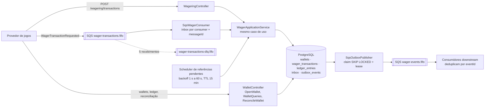
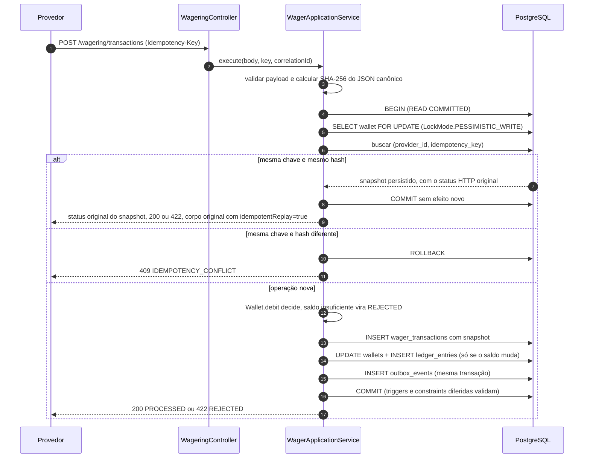
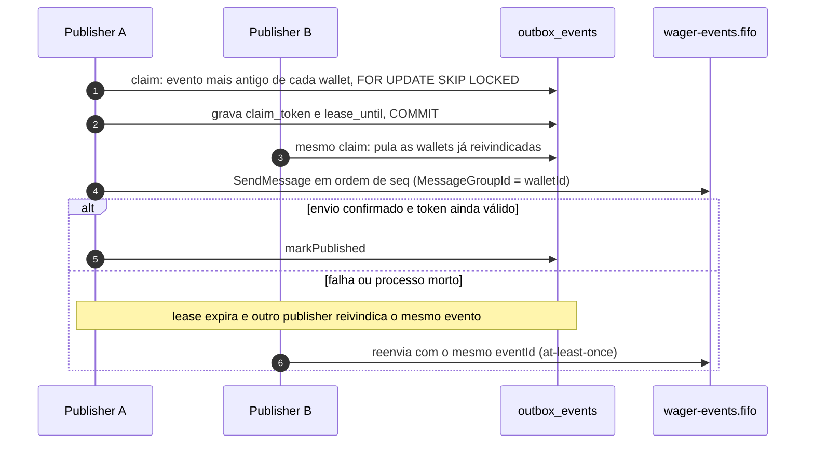

# Distributed Wagering Processor

Serviço financeiro que processa `BET`, `WIN`, `LOSS`, `REFUND` e `ROLLBACK` de vários provedores de jogos, por HTTP e por SQS FIFO.
Ele continua correto com mensagens duplicadas, fora de ordem ou simultâneas e com três ou mais instâncias no mesmo banco: dinheiro exato, lock por wallet, idempotência persistente, ledger append-only e eventos publicados só depois do commit.
O enunciado está em [docs/CHALLENGE.md](docs/CHALLENGE.md); as decisões detalhadas, em [ARCHITECTURE.md](ARCHITECTURE.md).

**Stack:** Bun 1.3.14 · TypeScript 5.9.3 (estrito) · NestJS 11.2.7 · MikroORM 6.6.17 · PostgreSQL 17.6 · SQS FIFO no LocalStack 4.9.2 · Docker Compose. Versões fixadas em `package.json`/`bun.lock`.

## Índice

1. [Início rápido](#início-rápido)
2. [Arquitetura visual](#arquitetura-visual)
3. [Decisões de arquitetura](#decisões-de-arquitetura)
4. [Verificação](#verificação)
5. [Demonstração manual](#demonstração-manual)
6. [Resultados de carga](#resultados-de-carga)
7. [Requisitos do enunciado → onde estão](#requisitos-do-enunciado--onde-estão)
8. [Segurança](#segurança)
9. [Limites e trade-offs](#limites-e-trade-offs)
10. [Mapa da documentação](#mapa-da-documentação)

## Início rápido

Pré-requisitos: Docker com Compose v2. Para os testes, Bun 1.3.14. Para os exemplos com `curl`, também `jq` e `uuidgen`.

```bash
docker compose up -d --build --wait          # PostgreSQL + SQS + migrations + 3 réplicas (HTTP + workers)
API=http://$(docker compose port --index 1 app 3037)
curl -s $API/health/ready                     # {"status":"ready", ...} com PostgreSQL e SQS "up"
docker compose down -v                        # derruba e apaga os dados
```

O Compose sobe PostgreSQL, LocalStack com as filas FIFO e DLQs, aplica as migrations com a credencial owner, cria o LOGIN de runtime e inicia três réplicas da aplicação, cada uma com HTTP, consumer SQS, publisher da outbox e scheduler. Não há balanceador: cada réplica tem sua porta em `127.0.0.1:3037-3046`. Réplicas, portas, variáveis e execução sem contêiner: [docs/workers.md](docs/workers.md#referência-operacional). Todas as variáveis da aplicação, com padrão e validação no boot (`HOST`, `NODE_ENV`, `JWP_ENABLED_CURRENCIES`, `JWP_ALLOW_INSECURE_LOCAL_AUTH` e as demais): [tabela de variáveis](docs/workers.md#variáveis-de-ambiente-e-validação-no-boot); modelo em [`.env.example`](.env.example).

## Arquitetura visual

### Componentes



Toda réplica executa os mesmos componentes. A coordenação entre réplicas não usa memória nem coordenador externo: está no PostgreSQL (lock de linha por wallet, constraints, claims com lease). O SQS só é tocado depois do commit.

### Um BET, do pedido ao commit



O replay não reavalia nada: devolve o status e o corpo gravados no snapshot (uma BET rejeitada por saldo repete 422 `INSUFFICIENT_FUNDS`), só trocando `idempotentReplay` para `true`. O lock vem antes da leitura da identidade e do saldo, então duas requisições da mesma wallet nunca decidem sobre o mesmo saldo. Pelo SQS, a única diferença é que a inbox é gravada na mesma transação e o `DeleteMessage` (ack) só acontece após o commit.

### Do commit até a fila de eventos



`seq` é gravado sob o lock da wallet, portanto segue a ordem de commit; só um publisher tem eventos de uma wallet em voo. Entre wallets diferentes, a publicação é paralela.

## Decisões de arquitetura

Uma linha por decisão. "ADR" é um registro de decisão de arquitetura: cada link abre a seção do [ARCHITECTURE.md](ARCHITECTURE.md) com motivo, alternativas e custos. São 14 ADRs (001–011, 014–016); os números 012 e 013 não existem.

| Decisão | Por quê | Onde no código | Como verificar | ADR |
|---|---|---|---|---|
| **Money em `bigint` de centavos**; string decimal na API e nos eventos, `numeric(20,2)` no banco | `number` perde centavos acima de 2^53 e arredonda em silêncio | [`src/shared/domain/money.ts`](src/shared/domain/money.ts#L14), [`src/persistence/financial-orm.ts`](src/persistence/financial-orm.ts) | `tests/unit/money.test.ts`; `financial-schema.test.ts` (`exact ORM string mapping above 2^53…`); matriz M02 | [001](ARCHITECTURE.md#jwp-adr-001--money-exato-com-escala-fixa) |
| **Lock por wallet** com `LockMode.PESSIMISTIC_WRITE` (`FOR UPDATE`) em transação curta, sem lock global | Serializa só quem disputa o mesmo saldo; wallets diferentes seguem em paralelo; menos retries que optimistic locking | [`sql-process-wager-store.ts:120`](src/wagering/infrastructure/sql-process-wager-store.ts#L120), [`sql-wallet-query-store.ts:63`](src/wallet/infrastructure/sql-wallet-query-store.ts#L63) | matriz M03 (100,00 com dois BETs de 80,00 em 3 instâncias); `multi-process.test.ts` (`100/80/80 on 20 wallets…`) | [002](ARCHITECTURE.md#jwp-adr-002--lock-por-wallet-em-transação-curta) |
| **Invariantes no schema**: saldo ≥ 0, identidades únicas, ledger encadeado por versão | Vale também para escrita concorrente ou SQL direto que pule a aplicação | [`financial-sql.ts:22`](src/persistence/migrations/financial-sql.ts#L22) (CHECK), [`:51`](src/persistence/migrations/financial-sql.ts#L51) (UNIQUE), [`:80`](src/persistence/migrations/financial-sql.ts#L80) (append em ordem de versão) | `tests/integration/schema/financial-schema.test.ts` | [003](ARCHITECTURE.md#jwp-adr-003--schema-e-barreiras-de-integridade) |
| **Ledger append-only** | Auditoria exige histórico imutável; reconciliação compara saldo com ledger | trigger `ledger_no_mutation` em [`financial-sql.ts:76`](src/persistence/migrations/financial-sql.ts#L76); role de runtime sem UPDATE/DELETE | matriz M07; `financial-schema.test.ts` (`runtime UPDATE/DELETE/TRUNCATE are denied…`) | [003](ARCHITECTURE.md#jwp-adr-003--schema-e-barreiras-de-integridade) |
| **Idempotência persistente** por `(provider_id, idempotency_key)`, hash SHA-256 do JSON canônico e snapshot da resposta | Timeout não diz se houve commit; o retry precisa recuperar o resultado, não repetir o efeito | [`process-wager.ts:82`](src/wagering/application/process-wager.ts#L82) (hash), [`sql-process-wager-store.ts:125`](src/wagering/infrastructure/sql-process-wager-store.ts#L125) e [`:127`](src/wagering/infrastructure/sql-process-wager-store.ts#L127) | matriz M04 (50 envios paralelos + 10 cópias SQS → um débito) e M06; M13 (restart) | [004](ARCHITECTURE.md#jwp-adr-004--idempotência-de-negócio-e-replay) |
| **Reversão única** por transação referenciada, somando REFUND e ROLLBACK | REFUND e ROLLBACK da mesma BET creditariam o stake duas vezes; a regra contém a do enunciado e é mais restrita | índice `wager_one_reversal` em [`Migration202610110004.ts`](src/persistence/migrations/Migration202610110004.ts#L7); [`wager-transaction.ts:281`](src/wagering/domain/wager-transaction.ts#L281) | matriz M08; segunda reversão → 422 `ALREADY_REVERSED` | [005](ARCHITECTURE.md#jwp-adr-005--referências-estados-e-reversão-única) |
| **Referência fora de ordem** vira `PENDING_REFERENCE`, resolvida pelo scheduler | A ordem entre canais não é garantida; esperar com prazo é melhor que rejeitar na hora | prazo de 15 min em [`process-wager.ts:102`](src/wagering/application/process-wager.ts#L102); backoff em [`pending-reference-scheduler.ts`](src/messaging/pending-reference-scheduler.ts#L52), claim em [`:144`](src/messaging/pending-reference-scheduler.ts#L144) | matriz M10; `multi-process.test.ts` (`REFUND/ROLLBACK delivered before the BET…`) | [005](ARCHITECTURE.md#jwp-adr-005--referências-estados-e-reversão-única) |
| **LOSS exige `"0.00"`** e não aceita referência; vira PROCESSED sem ledger | Registra o resultado da rodada sem inventar movimento de saldo | [`wager-transaction.ts:204`](src/wagering/domain/wager-transaction.ts#L204) | `tests/unit/wager-transaction.test.ts`; matriz M07 (sem ledger para LOSS) | [005](ARCHITECTURE.md#jwp-adr-005--referências-estados-e-reversão-única) |
| **Inbox persistente** por `(consumer_name, message_id)` e ack só após o commit | Redelivery do SQS não pode reaplicar efeito; ack antes do commit perderia trabalho | [`Migration202610120005.ts:13`](src/persistence/migrations/Migration202610120005.ts#L13); [`sql-inbox-process-wager-store.ts`](src/messaging/sql-inbox-process-wager-store.ts#L52); ack em [`sqs-wager-consumer.ts:270`](src/messaging/sqs-wager-consumer.ts#L270) | matriz M11; `recovery.test.ts` (`SIGKILL after the financial commit and before the SQS ack…`) | [006](ARCHITECTURE.md#jwp-adr-006--atomicidade-e-inbox) |
| **Transactional outbox** com claim `FOR UPDATE SKIP LOCKED`, lease e token | Não existe transação distribuída entre PostgreSQL e SQS; o evento só sai depois do commit e sobrevive a crash | INSERT em [`sql-process-wager-store.ts:187`](src/wagering/infrastructure/sql-process-wager-store.ts#L187); claim em [`sql-outbox-store.ts:100`](src/messaging/outbox/sql-outbox-store.ts#L100); envio em [`sqs-outbox-publisher.ts:57`](src/messaging/outbox/sqs-outbox-publisher.ts#L57) | `outbox-publisher.test.ts` (`two publishers claim disjoint rows…`); matriz M12; `recovery.test.ts` (publisher morto antes/depois do `SendMessage`) | [007](ARCHITECTURE.md#jwp-adr-007--sqs-e-outbox) |
| **Ordem por wallet** na publicação (`seq` + `MessageGroupId = walletId`) | O consumidor recebe os eventos de uma wallet na ordem de commit | [`Migration202610120007.ts`](src/persistence/migrations/Migration202610120007.ts#L6); [`sqs-outbox-publisher.ts:88`](src/messaging/outbox/sqs-outbox-publisher.ts#L88) | matriz M12; carga: downstream sem duplicados nem faltantes | [007](ARCHITECTURE.md#jwp-adr-007--sqs-e-outbox) |
| **Retry e DLQ**: visibilidade 3, 6, 12, 24, 48 s; DLQ após 5 recebimentos; heartbeat a cada 10 s | Separa falha transitória (retry), de negócio (ack) e permanente (DLQ) | [`sqs-wager-consumer.ts`](src/messaging/sqs-wager-consumer.ts#L288) | `consumer-resilience.test.ts`; matriz M11 (poison → DLQ) | [007](ARCHITECTURE.md#jwp-adr-007--sqs-e-outbox) |
| **Readiness exige PostgreSQL e SQS**; liveness não consulta dependências | O balanceador só deve mandar tráfego para quem consegue concluir uma operação | [`src/observability/readiness.ts`](src/observability/readiness.ts#L21) | `tests/integration/observability/readiness.test.ts` | [008](ARCHITECTURE.md#jwp-adr-008--runtime) |
| **Status HTTP distintos** (400, 409, 422, 202, 503, 500) por classe de situação | O provedor decide retry, consulta ou correção pelo status e pelo `code`, sem ler mensagem | [`src/wagering/http/wagering.module.ts`](src/wagering/http/wagering.module.ts#L20); tabela em [docs/HTTP.md](docs/HTTP.md#erros) | matriz M09 | [009](ARCHITECTURE.md#jwp-adr-009--http-códigos-e-diagnóstico) |
| **Autenticação como ponto de extensão** (`ProviderIdentityPort` + `ProviderAuthGuard` global) | O enunciado não pontua auth; a porta permite plugar um IdP OIDC sem tocar no domínio | [`provider-identity.ts:11`](src/shared/http/provider-identity.ts#L11); [`app.module.ts:23`](src/app.module.ts#L23) | `tests/unit/provider-identity.test.ts` | [010](ARCHITECTURE.md#jwp-adr-010--autenticação) |
| **FAILED auditável** para falha permanente conhecida de infraestrutura | Uma falha terminal precisa de registro consultável, sem ser confundida com rejeição financeira | [`src/shared/infrastructure/permanent-wager-failure.ts`](src/shared/infrastructure/permanent-wager-failure.ts) | `tests/integration/wager/permanent-failure.test.ts` | [011](ARCHITECTURE.md#jwp-adr-011--failed-auditável) |
| **MikroORM para transação e locks; SQL explícito** para claims e escritas críticas | Mantém visíveis e revisáveis os locks, fences e a ordem de escrita | [`sql-process-wager-store.ts:65`](src/wagering/infrastructure/sql-process-wager-store.ts#L65) | `process-wager.test.ts` (`LockMode keeps row locking and fresh SQL state…`) | [014](ARCHITECTURE.md#jwp-adr-014--mikroorm-como-infraestrutura-transacional-e-sql-explícito) |
| **Migrations em SQL manual** e guarda automática de drift contra as entidades MikroORM | O diff gerado pelo ORM não expressa índices parciais, CHECKs entre colunas, triggers e grants, e proporia apagar tabelas; o teste de drift pega entidade e migration divergentes | [`src/persistence/migrations/`](src/persistence/migrations/Migration202610110002.ts) (002–009) | [`tests/integration/schema/schema-drift.test.ts`](tests/integration/schema/schema-drift.test.ts) (`schema produced by the SQL migrations matches every MikroORM entity…` e controles negativos) | [015](ARCHITECTURE.md#jwp-adr-015--migrations-em-sql-manual-e-guarda-de-drift-contra-as-entidades) |
| **Multimoeda BRL/USD/EUR com escala 2** e allowlist opcional `JWP_ENABLED_CURRENCIES` validada no boot | O enunciado fixa escala 2 e pede conflitos de moeda testados; moedas de escala 2 não mudam a representação em centavos nem o comportamento de BRL | registro em [`currency.ts:14`](src/shared/domain/currency.ts#L14); allowlist em [`:82`](src/shared/domain/currency.ts#L82), chamada no boot em [`main.ts:17`](src/main.ts#L17); mismatch sob lock em [`sql-process-wager-store.ts:138`](src/wagering/infrastructure/sql-process-wager-store.ts#L138) | `tests/unit/currency.test.ts`; testes de integração de wallet, wager e mensageria com USD, `CURRENCY_MISMATCH` e `UNSUPPORTED_CURRENCY` | [016](ARCHITECTURE.md#jwp-adr-016--multimoeda-com-escala-fixa-e-evolução-para-cripto-e-câmbio) |

Domínio (`src/wallet/domain`, `src/wagering/domain`, `src/shared/domain`) não importa NestJS nem ORM. HTTP, consumer e scheduler chamam o mesmo `WagerApplicationService`; os adapters em `infrastructure/` controlam transação, lock e identidade durável.

## Verificação

Do mais rápido ao mais completo. Os testes de integração usam PostgreSQL e SQS reais em containers descartáveis (nada é mockado) e falham se a infraestrutura estiver ausente.

| # | Comando | O que prova | Resultado esperado |
|---|---|---|---|
| 1 | `bun install --frozen-lockfile && bun run check` | Typecheck, testes unitários de domínio, build e smoke HTTP/DI | exit 0; 133 testes unitários e 2 de smoke, 0 falhas, 925 asserções na [execução de referência de 14/10/2026](docs/evidence/README.md#execução-de-referência-de-14102026) |
| 2 | `bun run test:integration` | Reprodução completa: migrations, atomicidade, inbox, outbox, retry/DLQ, concorrência multiprocesso, crash recovery e a matriz M01–M14 | exit 0; na [execução de referência de 14/10/2026](docs/evidence/README.md#execução-de-referência-de-14102026), já com multimoeda: 83 etapas, 438 testes, 0 falhas, 4251 asserções |
| 3 | `bun scripts/reproduce/reproduce.sh --matrix-only` | Só a matriz de aceitação e os controles negativos | exit 0 |
| 4 | `bun run test:compose` | Sobe `compose.yml` do zero com imagem real e 3 réplicas; confere `/health/ready` de cada uma, schema, role de runtime e as 4 filas com redrive; encerra com `down -v` | exit 0; 18/18 verificações |
| 5 | `bun run test:load` | Carga contra PostgreSQL/SQS reais, com invariantes ao final | exit 0; 17 invariantes verdadeiras, downstream sem duplicados nem faltantes |

Os resultados da execução de referência, o ambiente, o sourceCommit e os exits estão em [docs/evidence/README.md](docs/evidence/README.md). A execução de referência de check e reprodução integral é de 14/10/2026, sobre o código atual com multimoeda e `LockMode`: 83 etapas, 438 testes, 0 falhas e 4251 asserções na reprodução; 133 testes unitários e 2 de smoke no check. A execução anterior, de 13/10/2026, continua publicada na mesma página como histórico (80 etapas, 398 testes e 4022 asserções, antes da multimoeda); o Compose passou 18/18; a carga padrão após LockMode passou 17/17 invariantes. Os JSONs acompanham a entrega.

A matriz (`tests/matrix/delivery/matrix.test.ts`) cobre os cenários da seção 13 do enunciado:

| Cenário do enunciado | Teste |
|---|---|
| Mesma aposta 50 vezes em paralelo | M04; `multi-process.test.ts` (`the same BET sent 50 times…`) |
| Duas apostas de 80,00 sobre 100,00 | M03 |
| Wallets distintas em paralelo | M05 |
| ≥ 3 processos simultâneos | M01; `multi-process.test.ts` (`three API instances, three SQS workers…`) |
| Worker morto depois do commit e antes do ack | `tests/recovery/crash/recovery.test.ts` |
| Dois publishers sobre a mesma outbox | M12; `outbox-publisher.test.ts` |
| ROLLBACK/REFUND antes da referência | M10 |
| Reinício com consistência final | M13; M14 (`wallet.balance == saldo reconstruído pelo ledger` para todas as wallets) |

Na 1ª tentativa da execução de referência, M14 e seu hook de limpeza excederam timeout por uma espera sem prazo no helper que para os processos da matriz. A causa, a correção limitada e as repetições estão em [docs/evidence](docs/evidence/README.md#causa-da-falha-de-m14-na-1ª-tentativa): o dreno dos pipes de cada processo da matriz agora tem prazo de 5 s após o exit (`DRAIN_GRACE_MS` em `tests/matrix/delivery/support.ts`).

A guarda de drift entre migrations SQL e entidades MikroORM ([ADR 015](ARCHITECTURE.md#jwp-adr-015--migrations-em-sql-manual-e-guarda-de-drift-contra-as-entidades)) roda na reprodução integral (`tests/integration/schema/schema-drift.test.ts`) e falha se uma entidade e uma migration divergirem.

Isolamento de execuções simultâneas (sufixos, portas, diretórios de saída): [docs/workers.md](docs/workers.md#reprodução-completa-bun-run-testintegration).

## Demonstração manual

Com a stack do [início rápido](#início-rápido) no ar:

```bash
API=http://$(docker compose port --index 1 app 3037)
API2=http://$(docker compose port --index 2 app 3037)
PLAYER=$(uuidgen)
WALLET=$(curl -s -X POST $API/wallets -H 'content-type: application/json' \
  -d "{\"playerId\":\"$PLAYER\",\"initialBalance\":{\"amount\":\"100.00\",\"currency\":\"BRL\"}}" | jq -r .id)
tx() { # tx <api> <externalId> <kind> <valor> [referência]; moeda em CUR (padrão BRL)
  REF=${5:+,\"referenceExternalTransactionId\":\"$5\"}
  curl -s -w ' HTTP %{http_code}\n' -X POST $1/wagering/transactions -H 'content-type: application/json' \
    -H "Idempotency-Key: provider-a:$2" \
    -d "{\"providerId\":\"provider-a\",\"externalTransactionId\":\"$2\",\"playerId\":\"$PLAYER\",\"walletId\":\"$WALLET\",\"roundId\":\"round-1\",\"gameId\":\"game-1\",\"kind\":\"$3\",\"money\":{\"amount\":\"$4\",\"currency\":\"${CUR:-BRL}\"}$REF}"
}
```

| Passo | Comando | Resultado esperado |
|---|---|---|
| 1. Concorrência | `tx $API bet-a BET 80.00 & tx $API2 bet-b BET 80.00 & wait` | uma resposta `PROCESSED` (HTTP 200) e outra `REJECTED`/`INSUFFICIENT_FUNDS` (HTTP 422), em réplicas diferentes |
| 2. Saldo | `curl -s $API/wallets/$WALLET` | `balance.amount` = `"20.00"` |
| 3. Idempotência | repita exatamente o comando do BET que venceu | mesma resposta, com `"idempotentReplay":true`; saldo continua `20.00` |
| 4. Conflito | `tx $API bet-a BET 10.00` (mesma chave, outro valor) | HTTP 409 `IDEMPOTENCY_CONFLICT` |
| 5. Reversão | `tx $API refund-1 REFUND 80.00 <bet vencedor>` | `PROCESSED`, saldo `100.00` |
| 6. Reversão única | `tx $API rollback-1 ROLLBACK 80.00 <bet vencedor>` | HTTP 422 `ALREADY_REVERSED`; saldo continua `100.00` |
| 7. LOSS | `tx $API loss-1 LOSS 0.00` | `PROCESSED`; saldo e versão não mudam |
| 8. Ledger e reconciliação | `curl -s $API/wallets/$WALLET/ledger` e `curl -s -X POST $API/wallets/$WALLET/reconciliation -H 'content-type: application/json' -d '{}'` | crédito de abertura, um débito e um crédito; `"consistent":true` e `difference` `0.00` |
| 9. Multimoeda | `curl -s -w ' HTTP %{http_code}\n' -X POST $API/wallets -H 'content-type: application/json' -d "{\"playerId\":\"$PLAYER\",\"initialBalance\":{\"amount\":\"50.00\",\"currency\":\"USD\"}}"` | HTTP 201: segunda wallet, em USD, do mesmo player |
| 10. Moeda divergente | `CUR=EUR tx $API bet-eur BET 1.00` (EUR na wallet BRL) | HTTP 400 `CURRENCY_MISMATCH`; saldo (`100.00` após o passo 7) e ledger não mudam |
| 11. Moeda desconhecida | `CUR=XYZ tx $API bet-xyz BET 1.00` | HTTP 400 `UNSUPPORTED_CURRENCY` |

`<bet vencedor>` é `bet-a` ou `bet-b`, conforme o passo 1. Payloads, status e códigos: [docs/HTTP.md](docs/HTTP.md).

## Resultados de carga

A [execução de referência após LockMode](docs/LOAD_TEST.md#execução-de-referência) tem resultados públicos em [docs/evidence/load/results.json](docs/evidence/load/results.json). A tabela abaixo conserva a varredura histórica, anterior à versão de referência.

`bun run test:load` roda contra PostgreSQL e SQS reais, com processos HTTP e de workers separados. É medição de um host de desenvolvimento compartilhado, uma execução por ponto, sem meta de RPS nem SLA. Metodologia e números completos: [docs/LOAD_TEST.md](docs/LOAD_TEST.md).

| Medição (varredura de 8, 32 e 64 VUs; 1 e 3 réplicas) | Resultado |
|---|---|
| Wallets distribuídas | 528 a 852 req/s; com 3 réplicas e 64 VUs, p99 de 231,6 ms |
| Hot wallet (todas as requisições na mesma wallet) | 208 a 264 req/s, ~4 ms de seção crítica por transação |
| Erros HTTP, retries e falhas SQL transitórias | 0 em todas as rodadas |
| Invariantes ao final (saldo = ledger, eventos completos) | 17/17 em todas as rodadas; downstream sem duplicados nem faltantes |
| SQS (100 comandos) | 92 a 99 msg/s com 1 processo de workers; 133 a 147 msg/s com 3 |

A varredura é anterior à mudança para `LockMode` de 13/10/2026. O código com `LockMode` tem execução de referência registrada em [docs/evidence](docs/evidence/README.md): reprodução integral com 438 testes e 4251 asserções (14/10/2026), Compose 18/18 e carga padrão com 17/17 invariantes e 42703/42703 eventos entregues. A varredura acima continua sendo a medição de escala por VUs e réplicas.

## Requisitos do enunciado → onde estão

| Seção do enunciado | Onde está atendida |
|---|---|
| §2 Autenticação | [ADR 010](ARCHITECTURE.md#jwp-adr-010--autenticação): ponto de extensão, sem IdP nesta entrega |
| §4 Stack e ORM | Stack acima; MikroORM em [ADR 014](ARCHITECTURE.md#jwp-adr-014--mikroorm-como-infraestrutura-transacional-e-sql-explícito); migrations 002–009 em `src/persistence/migrations` |
| §5 Restrições invioláveis | [Decisões](#decisões-de-arquitetura); mapa falha → mecanismo → teste no fim de [docs/CHALLENGE.md](docs/CHALLENGE.md#mecanismos-e-provas-das-falhas-eliminatórias) |
| §6 Modelo de domínio | `Money`, `Wallet`, `WagerTransaction`, `WalletLedgerEntry`, `InboxMessage`, `OutboxMessage` em `src/*/domain`; desvios do esqueleto em [ARCHITECTURE.md](ARCHITECTURE.md#desvios-do-esqueleto-do-enunciado) |
| §7 Regras de negócio e `failureCode` | [ADR 005](ARCHITECTURE.md#jwp-adr-005--referências-estados-e-reversão-única); taxonomia em [docs/HTTP.md](docs/HTTP.md#erros) |
| §8 Concorrência | [ADR 002](ARCHITECTURE.md#jwp-adr-002--lock-por-wallet-em-transação-curta); matriz M03/M05 |
| §9 API HTTP | [docs/HTTP.md](docs/HTTP.md) |
| §10 SQS | [ADR 006](ARCHITECTURE.md#jwp-adr-006--atomicidade-e-inbox), [ADR 007](ARCHITECTURE.md#jwp-adr-007--sqs-e-outbox), [docs/workers.md](docs/workers.md) |
| §11 Outbox e eventos | [ADR 007](ARCHITECTURE.md#jwp-adr-007--sqs-e-outbox); [contratos de mensageria](contracts/messaging/README.md) |
| §12 Observabilidade | `/metrics` (transações por status, duplicatas, retries, filas e DLQs, espera de lock, outbox pendente e idade, latência), logs JSON com `correlationId`; [ADR 009](ARCHITECTURE.md#jwp-adr-009--http-códigos-e-diagnóstico) |
| §13 Testes | [Verificação](#verificação) |
| Diferencial: teste de carga | [Resultados de carga](#resultados-de-carga) |

## Segurança

- **Método.** Auditoria com um checklist de auditoria de segurança baseado no guia da Cloudflare, sobre `src`, migrations, workers, Dockerfile e Compose. Os testes dinâmicos rodaram num sandbox Docker isolado, sem rede externa.
- **Resultado.** Nenhum achado confirmado. Concorrência, idempotência, reversão paralela, validação de quantias, injeção, cursor entre carteiras, logs e SQS seguraram nos testes. O registro de cada hipótese está em [FINDINGS.md](docs/security/FINDINGS.md).
- **Itens de implantação (sem severidade), ambos tratados depois da auditoria.**
  - *Bind e modo local:* corrigido em código e teste. `HOST` padrão é `127.0.0.1`, inclusive na imagem; o Compose define `HOST=0.0.0.0` dentro do container e publica a porta só em `127.0.0.1`. Com `NODE_ENV=production` e a identidade local, o boot falha com `INSECURE_LOCAL_AUTH_IN_PRODUCTION`, salvo `JWP_ALLOW_INSECURE_LOCAL_AUTH=true` (`tests/unit/deploy-hardening.test.ts`).
  - *IAM de quem publica na fila de comandos:* política de menor privilégio por componente documentada em [IAM.md](docs/security/IAM.md). Não foi verificada numa conta AWS real.
- **Escopo.** Vale para a matriz testada. Não houve revisão independente de cobertura, então isso não é uma afirmação de ausência de vulnerabilidades. Detalhes em [docs/security/](docs/security/README.md).

## Limites e trade-offs

Cada linha: decisão → custo → mitigação ou evolução.

- **Hot wallet serial.** Lock por linha, sem retries → uma wallet muito disputada fica em ~4 ms por transação → wallets distintas seguem em paralelo; para uma conta muito quente, a evolução seria saldo particionado (fora do escopo).
- **Eventos at-least-once.** Outbox transacional → um evento pode ser reenviado (crash entre `SendMessage` e `markPublished`) e a ordem vale por wallet, não entre wallets → consumidores deduplicam por `eventId`.
- **Ordem estrita por wallet na outbox.** Sem reordenação → a outbox de uma wallet quente drena 128–172 s depois de 30 s a 64 VUs (atraso, não perda) → `jwp_outbox_oldest_pending_age_seconds` com alerta sugerido de aviso acima de 60 s por 5 min e crítico acima de 300 s ([ARCHITECTURE.md](ARCHITECTURE.md#métricas-exigidas-e-séries-disponíveis)); evolução: publisher particionado por wallet.
- **Reversão mais restritiva que o enunciado.** Após uma REFUND, uma ROLLBACK da mesma BET é rejeitada (`ALREADY_REVERSED`) → um caso que o enunciado aceitaria vira erro → ROLLBACK de REFUND continua permitido, e o código de erro é explícito.
- **Sem autenticação real.** Modo local com `ProviderAuthGuard` no-op → qualquer chamada é aceita e o `providerId` não é autenticado → bind padrão `127.0.0.1` e boot recusado com `INSECURE_LOCAL_AUTH_IN_PRODUCTION` quando `NODE_ENV=production`, salvo opt-in `JWP_ALLOW_INSECURE_LOCAL_AUTH=true`; uma implantação pública precisa de um adapter de IdP ([docs/security/README.md](docs/security/README.md)).
- **Papéis explícitos.** `bun run start` sobe só HTTP → a mensageria precisa de `bun run start:workers` → o Compose já usa os dois papéis.
- **Moeda.** BRL, USD e EUR com escala 2, uma wallet por player e moeda, allowlist `JWP_ENABLED_CURRENCIES` validada no boot → sem conversão cambial e sem escala diferente de 2 → moeda divergente da wallet é `CURRENCY_MISMATCH` e desconhecida é `UNSUPPORTED_CURRENCY`; cripto e câmbio são evolução ([JWP-ADR-016](ARCHITECTURE.md#jwp-adr-016--multimoeda-com-escala-fixa-e-evolução-para-cripto-e-câmbio)).
- **Medições locais.** Carga com LocalStack num host compartilhado → os números não representam AWS nem produção → repetir a carga no ambiente alvo antes de dimensionar.

## Mapa da documentação

| Documento | Conteúdo |
|---|---|
| [docs/CHALLENGE.md](docs/CHALLENGE.md) | Enunciado original e mapa falha → mecanismo → teste |
| [ARCHITECTURE.md](ARCHITECTURE.md) | Decisões, alternativas, custos, fluxos detalhados e estados da transação |
| [docs/HTTP.md](docs/HTTP.md) | Rotas, payloads, status, códigos de erro, `Idempotency-Key` e readiness |
| [docs/workers.md](docs/workers.md) | Workers, retry/DLQ, SIGTERM e referência operacional (Compose, variáveis, execução local, smoke, reprodução, manifesto do pacote) |
| [docs/LOAD_TEST.md](docs/LOAD_TEST.md) | Metodologia, resultados e limites do teste de carga |
| [docs/STATUS.md](docs/STATUS.md) | O que funciona e limitações conhecidas |
| [docs/security/README.md](docs/security/README.md) | Auditoria de segurança: método, resultado, itens a validar e escopo |
| [docs/security/FINDINGS.md](docs/security/FINDINGS.md) | Registro de cada hipótese avaliada na auditoria |
| [docs/security/IAM.md](docs/security/IAM.md) | Políticas IAM de menor privilégio por componente (SQS e KMS) |
| [contracts/messaging/README.md](contracts/messaging/README.md) | Filas, envelopes e JSON Schemas dos eventos |
| [infra/postgres/README.md](infra/postgres/README.md) | Roles do PostgreSQL e privilégios de runtime |

## Autor

Thales Calgarotto — [currículo e portfólio](https://tcalgarotto.github.io/)

## Saídas locais de validação

`test-results/` é gerado localmente pela reprodução e pelo smoke do Compose. A carga também permite definir seu diretório de saída. O manifesto `.delivery-manifest.json` lista os hashes dos arquivos exportados.
