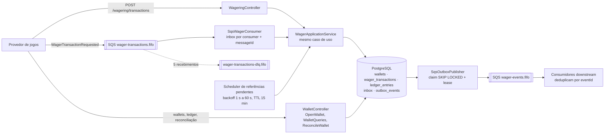
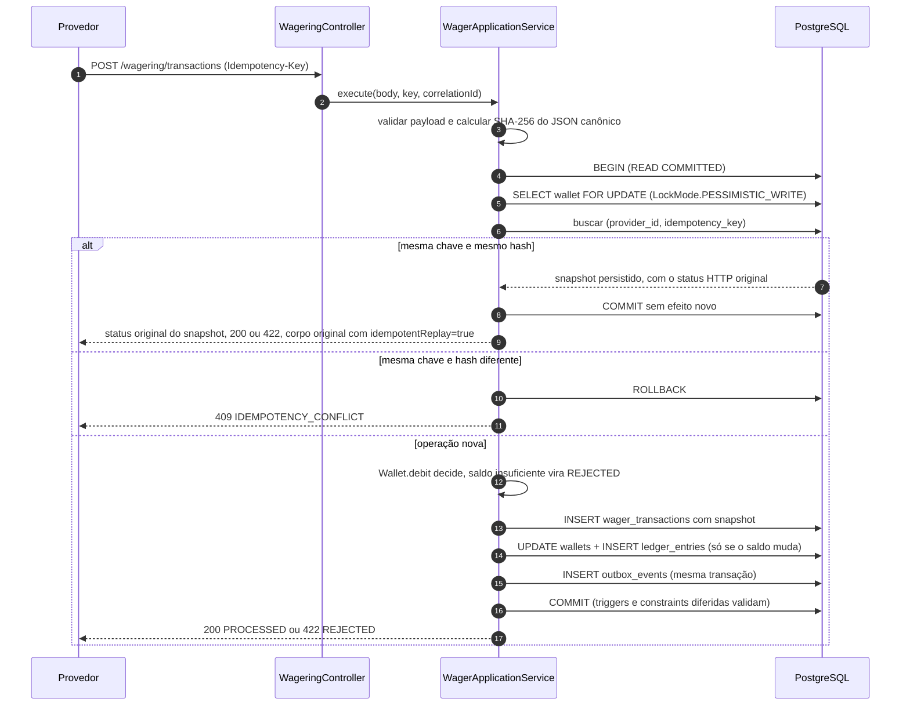
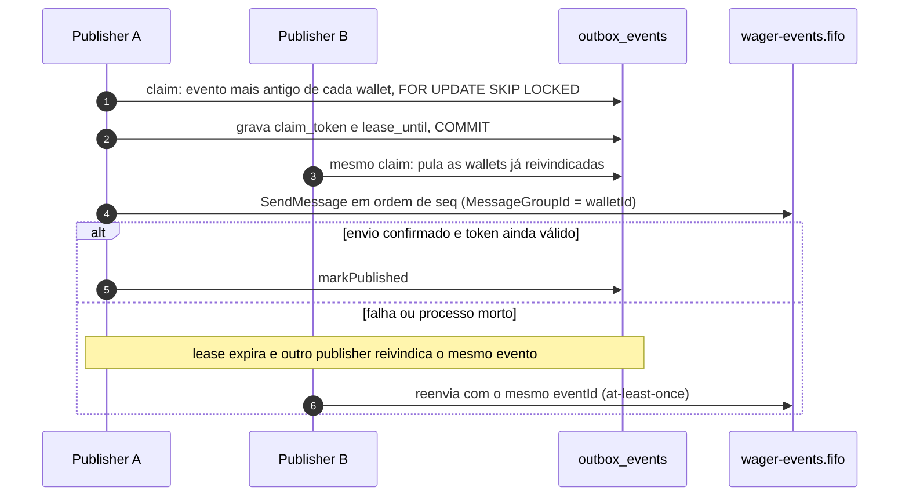

# Distributed Wagering Processor

Serviço financeiro que processa `BET`, `WIN`, `LOSS`, `REFUND` e `ROLLBACK` de vários provedores de jogos, por HTTP e por SQS FIFO, e continua correto com mensagens duplicadas, fora de ordem ou simultâneas e com três ou mais instâncias no mesmo banco.

## Leia em 10 minutos

- **O que é.** Resposta ao [enunciado](docs/CHALLENGE.md): wallets com dinheiro exato, lock por wallet, idempotência persistente, ledger append-only e eventos publicados só depois do commit (transactional outbox).
- **Como rodar.** `docker compose up -d --build --wait` sobe tudo ([início rápido](#início-rápido)); `bun run check` e `bun run test:integration` verificam ([verificação](#verificação)); a [demonstração manual](#demonstração-manual) mostra concorrência, idempotência e reversão com `curl`.
- **Decisões-chave.** `Money` em `bigint` de centavos; `SELECT … FOR UPDATE` por wallet; chave de idempotência persistida com hash e snapshot; inbox e outbox na mesma transação financeira; reversão padrão `per_type`, com `per_reference` opcional via `JWP_REVERSAL_POLICY`. Uma linha por decisão em [Decisões](#decisões-de-arquitetura); motivo, alternativas, código e testes em cada ADR do [ARCHITECTURE.md](ARCHITECTURE.md).
- **Onde está a evidência.** Resultados medidos, ambiente e exits em [docs/evidence](docs/evidence/README.md); cada requisito do enunciado aponta para o mecanismo e o teste em [Requisitos](#requisitos-do-enunciado--onde-estão).

**Stack:** Bun 1.3.14 · TypeScript 5.9.3 (estrito) · NestJS 11.2.7 · MikroORM 6.6.17 · PostgreSQL 17.6 · SQS FIFO no LocalStack 4.9.2 · Docker Compose. Versões fixadas em `package.json`/`bun.lock`.

## Índice

1. [Início rápido](#início-rápido)
2. [Arquitetura visual](#arquitetura-visual)
3. [Estrutura do código](#estrutura-do-código)
4. [Decisões de arquitetura](#decisões-de-arquitetura)
5. [Verificação](#verificação)
6. [Demonstração manual](#demonstração-manual)
7. [Resultados de carga](#resultados-de-carga)
8. [Requisitos do enunciado → onde estão](#requisitos-do-enunciado--onde-estão)
9. [Segurança](#segurança)
10. [Limites e trade-offs](#limites-e-trade-offs)
11. [Mapa da documentação](#mapa-da-documentação)

## Início rápido

Pré-requisitos: Docker com Compose v2. Para os testes, Bun 1.3.14. Para os exemplos com `curl`, também `jq` e `uuidgen`.

```bash
docker compose up -d --build --wait          # PostgreSQL + SQS + migrations + 3 réplicas (HTTP + workers)
API=http://$(docker compose port --index 1 app 3037)
curl -s $API/health/ready                     # {"status":"ready", ...} com PostgreSQL e SQS "up"
docker compose down -v                        # derruba e apaga os dados
```

O Compose sobe PostgreSQL, LocalStack com as filas FIFO e DLQs, aplica as migrations com a credencial owner, cria o LOGIN de runtime e inicia três réplicas da aplicação, cada uma com HTTP, consumer SQS, publisher da outbox e scheduler. Não há balanceador: cada réplica tem sua porta em `127.0.0.1:3037-3046`. Réplicas, portas, variáveis e execução sem contêiner: [docs/workers.md](docs/workers.md#referência-operacional). Todas as variáveis da aplicação, com padrão e validação no boot (`HOST`, `NODE_ENV`, `JWP_ENABLED_CURRENCIES`, `JWP_REVERSAL_POLICY`, `JWP_ALLOW_INSECURE_LOCAL_AUTH` e as demais): [tabela de variáveis](docs/workers.md#variáveis-de-ambiente-e-validação-no-boot); modelo em [`.env.example`](.env.example).

## Arquitetura visual

### Componentes



Toda réplica executa os mesmos componentes. A coordenação entre réplicas não usa memória nem coordenador externo: está no PostgreSQL (lock de linha por wallet, constraints, claims com lease). O SQS só é tocado depois do commit.

### Um BET, do pedido ao commit



O replay não reavalia nada: devolve o status e o corpo gravados no snapshot (uma BET rejeitada por saldo repete 422 `INSUFFICIENT_FUNDS`), só trocando `idempotentReplay` para `true`. O lock vem antes da leitura da identidade e do saldo, então duas requisições da mesma wallet nunca decidem sobre o mesmo saldo. Pelo SQS, a única diferença é que a inbox é gravada na mesma transação e o `DeleteMessage` (ack) só acontece após o commit.

### Do commit até a fila de eventos



`seq` é gravado sob o lock da wallet, portanto segue a ordem de commit; só um publisher tem eventos de uma wallet em voo. Entre wallets diferentes, a publicação é paralela.

## Estrutura do código

O enunciado descreve o modelo por componentes (§6, §10–§12), sem impor pastas. Cada componente vive num contexto de `src/`, dividido nas camadas `domain` (regras puras), `application` (casos de uso), `infrastructure` (SQL, transação, lock) e `http` (controllers):

| Componente do enunciado | Contexto em `src/` | Camadas e arquivos principais |
|---|---|---|
| `Money`, moedas, identificadores (§6.1) | `shared` | `domain/` (`money.ts`, `currency.ts`), `http/` (`provider-identity.ts`), `infrastructure/` (`sql-transaction.ts`, `permanent-wager-failure.ts`), `events/` |
| `Wallet`, `WalletLedgerEntry`, consultas e reconciliação (§6.2, §6.4, §9) | `wallet` | `domain/`, `application/`, `infrastructure/`, `http/`, `events/` |
| `WagerTransaction` e regras de negócio (§6.3, §7) | `wagering` | `domain/` (inclui `reversal-policy.ts`), `application/` (`process-wager.ts`), `infrastructure/`, `http/`, `events/` |
| Inbox, outbox, consumer SQS e scheduler (§6.5, §10, §11) | `messaging` | `domain/` (`inbox-message.ts`, `outbox-message.ts`), `outbox/` (publisher e store), adapters na raiz (`sqs-wager-consumer.ts`, `pending-reference-scheduler.ts`) |
| Métricas, logs e health checks (§12) | `observability` | `metrics.ts`, `log.ts`, `readiness.ts` |
| Schema, migrations e ORM (§4) | `persistence` | `migrations/` (SQL manual), `financial-orm.ts`, `migrate.ts` |
| Processos HTTP e workers | `runtime` (+ `main.ts`, `config/`) | `workers.ts` |

Domínio (`src/wallet/domain`, `src/wagering/domain`, `src/shared/domain`) não importa NestJS nem ORM. HTTP, consumer e scheduler chamam o mesmo `WagerApplicationService`; os adapters em `infrastructure/` controlam transação, lock e identidade durável.

## Decisões de arquitetura

Uma linha por decisão. "ADR" é um registro de decisão de arquitetura: cada link abre a seção do [ARCHITECTURE.md](ARCHITECTURE.md) com motivo, alternativas, custos, código e como verificar. São 14 ADRs (001–011, 014–016); os números 012 e 013 não existem.

| Decisão | Por quê | ADR |
|---|---|---|
| **Money em `bigint` de centavos** | `number` perde centavos acima de 2^53 e arredonda em silêncio | [001](ARCHITECTURE.md#jwp-adr-001--money-exato-com-escala-fixa) |
| **Lock por wallet** | Serializa só quem disputa o mesmo saldo; wallets diferentes seguem em paralelo; menos retries que optimistic locking | [002](ARCHITECTURE.md#jwp-adr-002--lock-por-wallet-em-transação-curta) |
| **Invariantes no schema** | Vale também para escrita concorrente ou SQL direto que pule a aplicação | [003](ARCHITECTURE.md#jwp-adr-003--schema-e-barreiras-de-integridade) |
| **Ledger append-only** | Auditoria exige histórico imutável; reconciliação compara saldo com ledger | [003](ARCHITECTURE.md#jwp-adr-003--schema-e-barreiras-de-integridade) |
| **Idempotência persistente** | Timeout não diz se houve commit; o retry precisa recuperar o resultado, não repetir o efeito | [004](ARCHITECTURE.md#jwp-adr-004--idempotência-de-negócio-e-replay) |
| **Política de reversão configurável**: padrão `per_type`; `per_reference` opcional via `JWP_REVERSAL_POLICY` | O enunciado só proíbe repetir o mesmo tipo. No padrão, REFUND seguido de ROLLBACK da mesma BET devolve o valor duas vezes (100,00 → BET 25,00 → REFUND → ROLLBACK = 125,00); `per_reference` aceita uma só reversão por referência, sem mudança de código nem migration | [005](ARCHITECTURE.md#jwp-adr-005--referências-estados-e-política-de-reversão) |
| **Referência fora de ordem** | A ordem entre canais não é garantida; esperar com prazo é melhor que rejeitar na hora | [005](ARCHITECTURE.md#jwp-adr-005--referências-estados-e-política-de-reversão) |
| **LOSS exige `"0.00"`** | Registra o resultado da rodada sem inventar movimento de saldo | [005](ARCHITECTURE.md#jwp-adr-005--referências-estados-e-política-de-reversão) |
| **Inbox persistente** | Redelivery do SQS não pode reaplicar efeito; ack antes do commit perderia trabalho | [006](ARCHITECTURE.md#jwp-adr-006--atomicidade-e-inbox) |
| **Transactional outbox** | Não existe transação distribuída entre PostgreSQL e SQS; o evento só sai depois do commit e sobrevive a crash | [007](ARCHITECTURE.md#jwp-adr-007--sqs-e-outbox) |
| **Ordem por wallet** | O consumidor recebe os eventos de uma wallet na ordem de commit | [007](ARCHITECTURE.md#jwp-adr-007--sqs-e-outbox) |
| **Retry e DLQ** | Separa falha transitória (retry), de negócio (ack) e permanente (DLQ) | [007](ARCHITECTURE.md#jwp-adr-007--sqs-e-outbox) |
| **Readiness exige PostgreSQL e SQS** | O balanceador só deve mandar tráfego para quem consegue concluir uma operação | [008](ARCHITECTURE.md#jwp-adr-008--runtime) |
| **Status HTTP distintos** | O provedor decide retry, consulta ou correção pelo status e pelo `code`, sem ler mensagem | [009](ARCHITECTURE.md#jwp-adr-009--http-códigos-e-diagnóstico) |
| **Autenticação como ponto de extensão** | O enunciado não pontua auth; a porta permite plugar um IdP OIDC sem tocar no domínio | [010](ARCHITECTURE.md#jwp-adr-010--autenticação) |
| **FAILED auditável** | Uma falha terminal precisa de registro consultável, sem ser confundida com rejeição financeira | [011](ARCHITECTURE.md#jwp-adr-011--failed-auditável) |
| **MikroORM para transação e locks; SQL explícito** | Mantém visíveis e revisáveis os locks, fences e a ordem de escrita | [014](ARCHITECTURE.md#jwp-adr-014--mikroorm-como-infraestrutura-transacional-e-sql-explícito) |
| **Migrations em SQL manual** | O diff gerado pelo ORM não expressa índices parciais, CHECKs entre colunas, triggers e grants, e proporia apagar tabelas; o teste de drift pega entidade e migration divergentes | [015](ARCHITECTURE.md#jwp-adr-015--migrations-em-sql-manual-e-guarda-de-drift-contra-as-entidades) |
| **Multimoeda BRL/USD/EUR com escala 2** | O enunciado fixa escala 2 e pede conflitos de moeda testados; moedas de escala 2 não mudam a representação em centavos nem o comportamento de BRL | [016](ARCHITECTURE.md#jwp-adr-016--multimoeda-com-escala-fixa-e-evolução-para-cripto-e-câmbio) |

## Verificação

Do mais rápido ao mais completo. Os testes de integração usam PostgreSQL e SQS reais em containers descartáveis (nada é mockado) e falham se a infraestrutura estiver ausente.

| # | Comando | O que prova | Resultado esperado |
|---|---|---|---|
| 1 | `bun install --frozen-lockfile && bun run check` | Typecheck, testes unitários de domínio, build e smoke HTTP/DI | exit 0; 133 testes unitários e 2 de smoke, 0 falhas, 925 asserções na [execução de referência de 14/10/2026](docs/evidence/README.md#execução-de-referência-de-14102026) |
| 2 | `bun run test:integration` | Reprodução completa: migrations, atomicidade, inbox, outbox, retry/DLQ, concorrência multiprocesso, crash recovery e a matriz M01–M14 | exit 0; na [execução de referência de 14/10/2026](docs/evidence/README.md#execução-de-referência-de-14102026), já com multimoeda: 83 etapas, 438 testes, 0 falhas, 4251 asserções |
| 3 | `bun scripts/reproduce/reproduce.sh --matrix-only` | Só a matriz de aceitação e os controles negativos | exit 0 |
| 4 | `bun run test:compose` | Sobe `compose.yml` do zero com imagem real e 3 réplicas; confere `/health/ready` de cada uma, schema, role de runtime e as 4 filas com redrive; encerra com `down -v` | exit 0; 18/18 verificações |
| 5 | `bun run test:load` | Carga contra PostgreSQL/SQS reais, com invariantes ao final | exit 0; 17 invariantes verdadeiras, downstream sem duplicados nem faltantes |

Resultados, ambiente, sourceCommit, exits e o histórico de 13/10/2026: [docs/evidence](docs/evidence/README.md). A guarda de drift entre migrations e entidades ([ADR 015](ARCHITECTURE.md#jwp-adr-015--migrations-em-sql-manual-e-guarda-de-drift-contra-as-entidades)) roda na reprodução integral. Isolamento de execuções simultâneas (sufixos, portas, diretórios de saída): [docs/workers.md](docs/workers.md#reprodução-completa-bun-run-testintegration).

## Demonstração manual

Com a stack do [início rápido](#início-rápido) no ar:

```bash
API=http://$(docker compose port --index 1 app 3037)
API2=http://$(docker compose port --index 2 app 3037)
PLAYER=$(uuidgen)
WALLET=$(curl -s -X POST $API/wallets -H 'content-type: application/json' \
  -d "{\"playerId\":\"$PLAYER\",\"initialBalance\":{\"amount\":\"100.00\",\"currency\":\"BRL\"}}" | jq -r .id)
tx() { # tx <api> <externalId> <kind> <valor> [referência]; moeda em CUR (padrão BRL)
  REF=${5:+,\"referenceExternalTransactionId\":\"$5\"}
  curl -s -w ' HTTP %{http_code}\n' -X POST $1/wagering/transactions -H 'content-type: application/json' \
    -H "Idempotency-Key: provider-a:$2" \
    -d "{\"providerId\":\"provider-a\",\"externalTransactionId\":\"$2\",\"playerId\":\"$PLAYER\",\"walletId\":\"$WALLET\",\"roundId\":\"round-1\",\"gameId\":\"game-1\",\"kind\":\"$3\",\"money\":{\"amount\":\"$4\",\"currency\":\"${CUR:-BRL}\"}$REF}"
}
```

| Passo | Comando | Resultado esperado |
|---|---|---|
| 1. Concorrência | `tx $API bet-a BET 80.00 & tx $API2 bet-b BET 80.00 & wait` | uma resposta `PROCESSED` (HTTP 200) e outra `REJECTED`/`INSUFFICIENT_FUNDS` (HTTP 422), em réplicas diferentes |
| 2. Saldo | `curl -s $API/wallets/$WALLET` | `balance.amount` = `"20.00"` |
| 3. Idempotência | repita exatamente o comando do BET que venceu | mesma resposta, com `"idempotentReplay":true`; saldo continua `20.00` |
| 4. Conflito | `tx $API bet-a BET 10.00` (mesma chave, outro valor) | HTTP 409 `IDEMPOTENCY_CONFLICT` |
| 5. Reversão | `tx $API refund-1 REFUND 80.00 <bet vencedor>` | `PROCESSED`, saldo `100.00` |
| 6. Segunda reversão | `tx $API rollback-1 ROLLBACK 80.00 <bet vencedor>` e depois `tx $API rollback-2 ROLLBACK 80.00 <bet vencedor>` | padrão `per_type`: o primeiro ROLLBACK é `PROCESSED` (HTTP 200) e o saldo vai a `180.00` (o stake é creditado duas vezes, REFUND + ROLLBACK); o segundo ROLLBACK é HTTP 422 `ALREADY_REVERSED` e o saldo continua `180.00`. Opcional: subindo a stack com `JWP_REVERSAL_POLICY=per_reference docker compose up -d --wait`, já o primeiro ROLLBACK é 422 `ALREADY_REVERSED` e o saldo fica em `100.00` |
| 7. LOSS | `tx $API loss-1 LOSS 0.00` | `PROCESSED`; saldo e versão não mudam |
| 8. Ledger e reconciliação | `curl -s $API/wallets/$WALLET/ledger` e `curl -s -X POST $API/wallets/$WALLET/reconciliation -H 'content-type: application/json' -d '{}'` | crédito de abertura, um débito e dois créditos (REFUND e ROLLBACK; com `per_reference`, um crédito); `"consistent":true` e `difference` `0.00` |
| 9. Multimoeda | `curl -s -w ' HTTP %{http_code}\n' -X POST $API/wallets -H 'content-type: application/json' -d "{\"playerId\":\"$PLAYER\",\"initialBalance\":{\"amount\":\"50.00\",\"currency\":\"USD\"}}"` | HTTP 201: segunda wallet, em USD, do mesmo player |
| 10. Moeda divergente | `CUR=EUR tx $API bet-eur BET 1.00` (EUR na wallet BRL) | HTTP 400 `CURRENCY_MISMATCH`; saldo (`180.00` após o passo 7; `100.00` com `per_reference`) e ledger não mudam |
| 11. Moeda desconhecida | `CUR=XYZ tx $API bet-xyz BET 1.00` | HTTP 400 `UNSUPPORTED_CURRENCY` |

`<bet vencedor>` é `bet-a` ou `bet-b`, conforme o passo 1. Payloads, status e códigos: [docs/HTTP.md](docs/HTTP.md).

## Resultados de carga

`bun run test:load` roda contra PostgreSQL e SQS reais, com processos HTTP e de workers separados, e confere 17 invariantes ao final (saldo = ledger, eventos completos, sem duplicados); sem meta de RPS nem SLA. Metodologia e roteiro: [docs/LOAD_TEST.md](docs/LOAD_TEST.md).
Referência atual (14/10/2026, candidata final, 3 HTTP + 3 workers, 32 VUs): `per_type`/`per_reference` com 583/543 req/s distribuído (p95 105/130 ms, p99 142/183 ms), 0% de erros e 17/17 invariantes nas duas políticas; desempenho equivalente dentro do ruído (uma rodada cada, diferenças de 10–20% para os dois lados; `per_reference` custa uma checagem indexada mais um advisory lock por referência no gatilho e existe para evitar a devolução dupla de REFUND+ROLLBACK, [ADR-005](ARCHITECTURE.md#jwp-adr-005--referências-estados-e-política-de-reversão)); tabela completa em [docs/evidence](docs/evidence/README.md#carga-da-candidata-final-14102026).
Histórico (13/10/2026, anterior à multimoeda, à política de reversão configurável e às métricas de contenção): 718,2 req/s distribuído, 229,1 req/s numa hot wallet e 259,9 req/s no hot drain, 0% de erros HTTP, 17/17 invariantes e 42703/42703 eventos entregues ([tabela](docs/evidence/README.md#carga-padrão-após-lockmode)); a queda é compatível com o custo da multimoeda, sem comparação controlada.
Em outro host a vazão muda; as invariantes devem se manter. A medição da versão final usa o mesmo comando, com `jwp_lock_conflicts_total` ([roteiro](docs/LOAD_TEST.md#execução-da-versão-final)).

## Requisitos do enunciado → onde estão

| Seção do enunciado | Onde está atendida |
|---|---|
| §2 Autenticação | [ADR 010](ARCHITECTURE.md#jwp-adr-010--autenticação): ponto de extensão, sem IdP nesta entrega |
| §4 Stack e ORM | Stack acima; MikroORM em [ADR 014](ARCHITECTURE.md#jwp-adr-014--mikroorm-como-infraestrutura-transacional-e-sql-explícito); migrations 002–009 em `src/persistence/migrations` |
| §5 Restrições invioláveis | [Decisões](#decisões-de-arquitetura) e [falhas eliminatórias](#falhas-eliminatórias-mecanismo-e-prova) abaixo |
| §6 Modelo de domínio | `Money`, `Wallet`, `WagerTransaction`, `WalletLedgerEntry`, `InboxMessage`, `OutboxMessage` em `src/*/domain`; desvios do esqueleto em [ARCHITECTURE.md](ARCHITECTURE.md#desvios-do-esqueleto-do-enunciado) |
| §7 Regras de negócio e `failureCode` | [ADR 005](ARCHITECTURE.md#jwp-adr-005--referências-estados-e-política-de-reversão); taxonomia em [docs/HTTP.md](docs/HTTP.md#erros) |
| §8 Concorrência | [ADR 002](ARCHITECTURE.md#jwp-adr-002--lock-por-wallet-em-transação-curta); matriz M03/M05 |
| §9 API HTTP | [docs/HTTP.md](docs/HTTP.md) |
| §10 SQS | [ADR 006](ARCHITECTURE.md#jwp-adr-006--atomicidade-e-inbox), [ADR 007](ARCHITECTURE.md#jwp-adr-007--sqs-e-outbox), [docs/workers.md](docs/workers.md) |
| §11 Outbox e eventos | [ADR 007](ARCHITECTURE.md#jwp-adr-007--sqs-e-outbox); [contratos de mensageria](contracts/messaging/README.md) |
| §12 Observabilidade | `/metrics` (transações por status, duplicatas, retries, filas e DLQs, espera de lock, outbox pendente e idade, latência), logs JSON com `correlationId`; [ADR 009](ARCHITECTURE.md#jwp-adr-009--http-códigos-e-diagnóstico) |
| §13 Testes | [Verificação](#verificação) e [cenários obrigatórios](#cenários-obrigatórios-do-13) abaixo |
| Diferencial: teste de carga | [Resultados de carga](#resultados-de-carga) |

### Cenários obrigatórios do §13

A matriz (`tests/matrix/delivery/matrix.test.ts`) cobre os cenários da seção 13 do enunciado:

| Cenário do enunciado | Teste |
|---|---|
| Mesma aposta 50 vezes em paralelo | M04; `multi-process.test.ts` (`the same BET sent 50 times…`) |
| Duas apostas de 80,00 sobre 100,00 | M03 |
| Wallets distintas em paralelo | M05 |
| ≥ 3 processos simultâneos | M01; `multi-process.test.ts` (`three API instances, three SQS workers…`) |
| Worker morto depois do commit e antes do ack | `tests/recovery/crash/recovery.test.ts` |
| Dois publishers sobre a mesma outbox | M12; `outbox-publisher.test.ts` |
| ROLLBACK/REFUND antes da referência | M10 |
| Reinício com consistência final | M13; M14 (`wallet.balance == saldo reconstruído pelo ledger` para todas as wallets) |

### Falhas eliminatórias: mecanismo e prova

Cada falha eliminatória do §14 relacionada à barreira da implementação e ao teste que a prova (PostgreSQL e SQS reais):

| Eliminatória | Mecanismo existente | Teste que prova |
|---|---|---|
| `number` para dinheiro | [src/shared/domain/money.ts:14](src/shared/domain/money.ts#L14), centavos bigint e entrada/saída string; `src/persistence/financial-orm.ts`, mapeamento decimal exato | `tests/integration/schema/financial-schema.test.ts`: `exact ORM string mapping above 2^53, cent dirty checking and input scale/range rejection` |
| Saldo negativo por corrida | [src/wagering/infrastructure/sql-process-wager-store.ts:120](src/wagering/infrastructure/sql-process-wager-store.ts#L120), LockMode.PESSIMISTIC_WRITE (FOR UPDATE) por wallet; CHECK do saldo no schema | `tests/concurrency/multi-process/multi-process.test.ts`: `100/80/80 on 20 wallets in parallel: HTTP x HTTP on different instances and HTTP x SQS each debit exactly once` |
| Débito/crédito duplicado | [src/persistence/migrations/financial-sql.ts:51](src/persistence/migrations/financial-sql.ts#L51) e `:71`, identidades e lançamentos únicos; inbox durável | `tests/matrix/delivery/matrix.test.ts`: `M04 the same BET 50 times in parallel on three instances plus 10 SQS copies debits exactly once` |
| Idempotência só em memória | [src/wagering/infrastructure/sql-process-wager-store.ts:127](src/wagering/infrastructure/sql-process-wager-store.ts#L127), comparação do hash e snapshot em SQL; lookup persistido em [sql-process-wager-store.ts:125](src/wagering/infrastructure/sql-process-wager-store.ts#L125); UNIQUE por provedor | `tests/matrix/delivery/matrix.test.ts`: `M06 persistent idempotency: replay keeps the original result across instances; conflicts and missing key are distinct`; `M13 restart: all API instances replaced; replays, balances and reconciliation unchanged` |
| Correto só com uma instância | [src/wagering/infrastructure/sql-process-wager-store.ts:65](src/wagering/infrastructure/sql-process-wager-store.ts#L65), TX SQL compartilhada; locks/fences no banco | `tests/concurrency/multi-process/multi-process.test.ts`: `three API instances, three SQS workers, two publishers and three schedulers run as distinct Bun processes` |
| Publicar antes do commit | [src/wagering/infrastructure/persist-wager-effects.ts:47](src/wagering/infrastructure/persist-wager-effects.ts#L47), outbox na TX financeira; [src/messaging/outbox/sqs-outbox-publisher.ts:57](src/messaging/outbox/sqs-outbox-publisher.ts#L57), claim confirmado antes do envio | `tests/integration/messaging/outbox/outbox-publisher.test.ts`: `two publishers claim disjoint rows, call real SQS after commit, and never publish into the commands queue` |
| Ledger não auditável | [src/persistence/migrations/financial-sql.ts:76](src/persistence/migrations/financial-sql.ts#L76), imutabilidade por trigger e privilégios; cadeia before/after e reconciliação | `tests/matrix/delivery/matrix.test.ts`: `M07 auditable append-only ledger: cursor pages, chained balances, no ledger for LOSS/REJECTED, UPDATE/DELETE refused`; `tests/integration/schema/financial-schema.test.ts`: `runtime UPDATE/DELETE/TRUNCATE are denied; owner triggers independently forbid ledger mutation` |
| Testes que mockam PG/SQS | [tests/concurrency/multi-process/support.ts:14](tests/concurrency/multi-process/support.ts#L14), infraestrutura obrigatória; [tests/integration/sqs/support/sqs.ts:26](tests/integration/sqs/support/sqs.ts#L26), probe SQS real; runner reprova ausência | `tests/concurrency/multi-process/multi-process.test.ts`: `three API instances, three SQS workers, two publishers and three schedulers run as distinct Bun processes`; controles negativos e suítes reais no runner de reprodução |

## Segurança

- **Método e resultado.** Auditoria com checklist baseado no guia da Cloudflare sobre `src`, migrations, workers, Dockerfile e Compose, com testes dinâmicos num sandbox Docker isolado, sem rede externa: nenhum achado confirmado. Cada hipótese está em [FINDINGS.md](docs/security/FINDINGS.md).
- **Itens de implantação (sem severidade), tratados depois da auditoria.** `HOST` padrão `127.0.0.1`, com o Compose usando `HOST=0.0.0.0` só dentro do container e publicando em `127.0.0.1`; boot recusado com `INSECURE_LOCAL_AUTH_IN_PRODUCTION` (ver [Limites](#limites-e-trade-offs), `tests/unit/deploy-hardening.test.ts`). IAM de menor privilégio por componente em [IAM.md](docs/security/IAM.md), não verificado numa conta AWS real.
- **Escopo.** Vale para a matriz testada, sem revisão independente de cobertura: não é afirmação de ausência de vulnerabilidades. Detalhes em [docs/security/](docs/security/README.md).

## Limites e trade-offs

Cada linha: decisão → custo → mitigação ou evolução.

- **Hot wallet serial.** Lock por linha, sem retries → uma wallet muito disputada fica em ~4 ms por transação → wallets distintas seguem em paralelo; para uma conta muito quente, a evolução seria saldo particionado (fora do escopo).
- **Eventos at-least-once.** Outbox transacional → um evento pode ser reenviado (crash entre `SendMessage` e `markPublished`) e a ordem vale por wallet, não entre wallets → consumidores deduplicam por `eventId`.
- **Ordem estrita por wallet na outbox.** Sem reordenação → a outbox de uma wallet quente drena 128–172 s depois de 30 s a 64 VUs (atraso, não perda) → `jwp_outbox_oldest_pending_age_seconds` com alerta sugerido de aviso acima de 60 s por 5 min e crítico acima de 300 s ([ARCHITECTURE.md](ARCHITECTURE.md#métricas-exigidas-e-séries-disponíveis)); evolução: publisher particionado por wallet.
- **REFUND+ROLLBACK devolvem o stake duas vezes no padrão.** A política padrão `per_type` segue o enunciado (um REFUND e um ROLLBACK por referência) → REFUND e ROLLBACK da mesma BET são ambos aplicados e o stake é creditado duas vezes → `JWP_REVERSAL_POLICY=per_reference` limita a uma reversão por referência (a segunda vira `ALREADY_REVERSED`); todas as réplicas devem usar o mesmo valor ([ADR-005](ARCHITECTURE.md#jwp-adr-005--referências-estados-e-política-de-reversão)).
- **Sem autenticação real.** Modo local com `ProviderAuthGuard` no-op → qualquer chamada é aceita e o `providerId` não é autenticado → bind padrão `127.0.0.1` e boot recusado com `INSECURE_LOCAL_AUTH_IN_PRODUCTION` quando `NODE_ENV=production`, salvo opt-in `JWP_ALLOW_INSECURE_LOCAL_AUTH=true`; uma implantação pública precisa de um adapter de IdP ([docs/security/README.md](docs/security/README.md)).
- **Papéis explícitos.** `bun run start` sobe só HTTP → a mensageria precisa de `bun run start:workers` → o Compose já usa os dois papéis.
- **Moeda.** BRL, USD e EUR com escala 2, uma wallet por player e moeda, allowlist `JWP_ENABLED_CURRENCIES` validada no boot → sem conversão cambial e sem escala diferente de 2 → moeda divergente da wallet é `CURRENCY_MISMATCH` e desconhecida é `UNSUPPORTED_CURRENCY`; cripto e câmbio são evolução ([JWP-ADR-016](ARCHITECTURE.md#jwp-adr-016--multimoeda-com-escala-fixa-e-evolução-para-cripto-e-câmbio)).
- **Medições locais.** Carga com LocalStack num host compartilhado → os números não representam AWS nem produção → repetir a carga no ambiente alvo antes de dimensionar.

## Mapa da documentação

| Documento | Conteúdo |
|---|---|
| [docs/CHALLENGE.md](docs/CHALLENGE.md) | Enunciado original |
| [ARCHITECTURE.md](ARCHITECTURE.md) | Decisões, alternativas, custos, fluxos detalhados e estados da transação |
| [docs/HTTP.md](docs/HTTP.md) | Rotas, payloads, status, códigos de erro, `Idempotency-Key` e readiness |
| [docs/workers.md](docs/workers.md) | Workers, retry/DLQ, SIGTERM e referência operacional (Compose, variáveis, execução local, smoke, reprodução, manifesto do pacote) |
| [docs/LOAD_TEST.md](docs/LOAD_TEST.md) | Metodologia, resultados e limites do teste de carga |
| [docs/STATUS.md](docs/STATUS.md) | O que funciona e limitações conhecidas |
| [docs/security/README.md](docs/security/README.md) | Auditoria de segurança: método, resultado, itens a validar e escopo |
| [docs/security/FINDINGS.md](docs/security/FINDINGS.md) | Registro de cada hipótese avaliada na auditoria |
| [docs/security/IAM.md](docs/security/IAM.md) | Políticas IAM de menor privilégio por componente (SQS e KMS) |
| [contracts/messaging/README.md](contracts/messaging/README.md) | Filas, envelopes e JSON Schemas dos eventos |
| [infra/postgres/README.md](infra/postgres/README.md) | Roles do PostgreSQL e privilégios de runtime |

## Autor

Thales Calgarotto — [currículo e portfólio](https://tcalgarotto.github.io/)

## Saídas locais de validação

`test-results/` é gerado localmente pela reprodução e pelo smoke do Compose. A carga também permite definir seu diretório de saída. O manifesto `.delivery-manifest.json` lista os hashes dos arquivos exportados.
